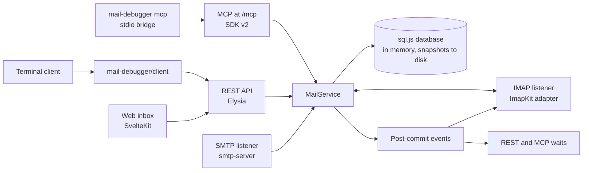

# Architecture

mail-debugger is one Node.js process with up to three listeners (SMTP, HTTP, IMAP) around a single mailbox. This page explains how the parts fit together; [CONTRIBUTING.md](../CONTRIBUTING.md) lists the projects and commands.

## The mailbox

`apps/server/src/mail/mail-service.ts` is the only writer. SMTP deliveries, REST and MCP deletions and IMAP flag changes and expunges all go through it. Every change runs in one database transaction; only after the commit does the service emit an event (`inserted`, `deleted`, `flags`) with the origin of the change, so each surface can ignore its own changes and react to the others. Waits (`GET /api/emails/wait`, the MCP tool `wait_for_email`) subscribe before they check the store, so no arrival is missed.

Storage is [sql.js](https://sql.js.org), SQLite compiled to WebAssembly, so no native database binary is needed on any platform. The database lives in memory. With `--data-dir` or `--persist` it is written to `mail-debugger.sqlite` 250 ms after the last change (to a temporary file that replaces the old one) and when the server stops; a lock file keeps a second process out. Each message keeps its exact source bytes next to the parsed fields, the SMTP envelope, IMAP flags and its stored size. Ids double as IMAP UIDs and are never reused; the data set has a `mailboxId` and a UIDVALIDITY. Schema migrations (`db/migrations.ts`) run in a transaction after a backup copy of the old file.

Limits on message size, message count and stored bytes are enforced by the service; SMTP turns them into 552 and 452 answers.

## Listeners

`runtime.ts` starts the configured listeners, reports their bound ports, cleans up when one fails to start, and closes them in order on shutdown: stop accepting mail, end waits, close HTTP, SMTP and IMAP, flush the database. `run-server.ts` wraps this for the command line (signals, IPC `shutdown`, exit codes), and `config.ts` parses the options strictly.

- **SMTP** (`smtp/`) uses [smtp-server](https://nodemailer.com/extras/smtp-server/). It streams message data with a size cap, stores the envelope, and checks configured credentials in constant time. `smtp/tls.ts` loads or generates the certificate shared with IMAP.
- **HTTP** (`api/`) is an [Elysia](https://elysiajs.com) app served by `node:http` through srvx. Guards run first for every request: Host and Origin checks, then the bearer tokens of `/api` and `/mcp`. Routes validate their parameters and answer `{ error: { code, message } }`. The OpenAPI document comes from `@elysiajs/openapi`. Static files of the web inbox are resolved strictly inside its directory, with a fallback to `index.html` for client-side routes.
- **IMAP** (`imap/`, loaded only with `--imap`) uses [ImapKit](https://github.com/postalsys/imapkit) as protocol engine on an in-memory mirror of the mailbox. `mailbox-adapter.ts` keeps the mirror in step with the service in both directions: IMAP flag changes and expunges are stored before any response or notification leaves, and are rolled back if storing fails; changes from other surfaces reach sessions as `EXISTS`, `FETCH` and `EXPUNGE`. `mailbox-plugin.ts` defines the restricted capability profile and refuses everything that would create mail or folders. `output-control.ts` bounds the output per session and splits large FETCH responses. See [imap.md](imap.md).
- **MCP** (`mcp/`, loaded only with `--mcp`) uses the official TypeScript SDK v2 in stateless mode: every HTTP request gets a fresh MCP server over the shared service. `tools.ts` holds the tools with their strict Zod schemas, output limits and error codes. `bridge.ts` is `mail-debugger mcp`, which connects to a running server over HTTP and serves its tools on stdio without a mailbox of its own. See [mcp.md](mcp.md).

## Clients

- `libs/client` is the public `mail-debugger/client`: the wire types and a small fetch-based client with typed errors, timeouts and abort signals. It has no dependencies, works in Node.js and browsers and is compiled with `tsc` to ESM and declarations.
- `apps/web` is the web inbox, a static SvelteKit app that uses the client from the same origin. HTML mail is rendered in a sandboxed iframe whose document carries a Content-Security-Policy.
- `apps/cli` is the terminal client: direct commands on top of the client, and an interactive inbox built with [Rezi](https://github.com/RtlZeroMemory/Rezi), loaded only when it starts. All text from captured mail passes through `formatter/terminal-safe.ts` before it reaches a terminal.

## Builds and distributions

esbuild bundles the server and the CLI. The main bundle (`apps/server/dist`) contains the workspace code, the OpenAPI plugin and Rezi's JavaScript; the other npm packages stay external and are dependencies of `mail-debugger` (among them sql.js with its WebAssembly, pino with its transport worker, Elysia, the MCP SDK, ImapKit and `@rezi-ui/native` with its prebuilt binaries). Lazily loaded parts become separate chunks: the terminal client, the interactive inbox, the IMAP listener, MCP and the stdio bridge. The slim bundle (`apps/server/dist-api`) contains everything but sql.js, pino and pino-pretty in one file. `packages/api` and `packages/cli` copy their bundles and add their own manifests.

| Distribution        | Contents                                              |
| ------------------- | ----------------------------------------------------- |
| `mail-debugger`     | Root `package.json`: server bundle, web inbox, client |
| `mail-debugger-api` | `packages/api`: slim server bundle                    |
| `mail-debugger-cli` | `packages/cli`: terminal client bundle                |

`scripts/pack-and-smoke.mjs` checks what each tarball contains and runs the installed packages; the release workflow publishes exactly the tarballs it tested ([release.md](release.md)).
