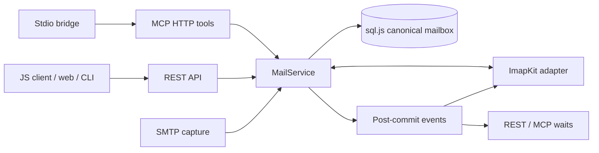

# mail-debugger completion plan

Research date: 2026-10-11. Planning only. This document is the sole repository write made during this review; no source, manifest, lockfile, branch, commit, tag, stash, or remote setting is changed.

## 1. Outcome and decision baseline

Ship the remaining roadmap surfaces from the existing `mail-debugger` package: an ESM JavaScript/TypeScript client at `mail-debugger/client`, an optional IMAP listener, and MCP over HTTP plus a stdio bridge subcommand. Keep the web inbox, REST API, SMTP capture, and terminal client working against one mailbox. Finish with reproducible installs, protocol integration tests, installed-tarball tests, hardened OIDC publishing, and contributor/security documentation.

Recommend **0.4.0**, followed by a documented 1.0 stabilization milestone after real-world protocol feedback. Completing a feature checklist does not establish a stable public API or broad mail-client interoperability. Raising the Node floor and changing CLI/security defaults must be prominent in the 0.4.0 changelog. Remove the README roadmap only after all acceptance criteria below pass; replace it with supported features and explicit protocol limitations.

Implementation stays on `feat/claude-d8f0/mail-debugger`, uses English and Conventional Commits without AI attribution, and creates no team PR. Merge into `main` only when all required checks pass. The coordinator releases after Oliver confirms; implementers must neither push `v*` tags nor dispatch publishing.

### Evidence inspected

- Checked-out branch: `feat/claude-d8f0/mail-debugger`; initial working tree clean. Main baseline: `581c0f5` (0.3.2).
- Existing commits: `a3d8674` (LF policy), `449a0a7` (Nx 23 / TypeScript 6 migration).
- Read `CLAUDE.md`, root/workspace manifests, workflows, the tcp-proxy publishing reference, REST routes, internal client/types, server entry points, and existing E2E harness. `CLAUDE.md` refers to Nx skills/MCP capabilities that are not supplied in this session; no generator or repository-local task was run on that basis.
- Evaluated the saved `wip-client-consolidation.patch` as a proposal, not a source of accepted decisions. Its lockfile deletion is explicitly excluded from adoption.
- Current REST routes are `GET /api/health`, `GET /api/emails`, `GET /api/emails/:id`, `DELETE /api/emails/:id`, and `DELETE /api/emails`. There is no attachment-download or wait endpoint today.
- Current server binds SMTP to `0.0.0.0`; accepts any SMTP credentials; TLS is optional. Configuration silently ignores unknown arguments. Web/API lifecycle and SMTP lifecycle are duplicated between `main.ts` and `main-api.ts`.
- Existing CI does not execute the server E2E target; publishing omits web and E2E quality gates. Package wrapper test targets use `--passWithNoTests`, which is not package verification.

This completed plan was written incrementally. Registry versions/dates, protocol choices, and experiments are supported below; acceptance criteria describe future implementation gates, not work already implemented.

## 2. Started work: retain the intent, review the changes

**Keep `a3d8674`.** LF source files and deterministic formatting are appropriate on Windows and Linux. Do not rewrite its history merely to combine it with later work.

**Keep the Nx/TypeScript migration as a starting point, subject to the compatibility and clean-install gate in section 3.** All Nx packages must move together. Review removed TypeScript options, project references, inferred targets, and disabled sync generators against the actual target toolchain. A committed lockfile proves resolution, not Windows ARM64 installation or build compatibility.

**Change the client-consolidation proposal rather than applying the patch wholesale.** Consolidating `libs/api-client` and `libs/types` into `libs/client` is sensible for this project: one small framework-free module owns the wire DTOs, filter helpers, and fetch client. Server code may import DTOs/helpers without instantiating the HTTP client. Web and CLI reuse the REST client; the bridge shares tool contracts/types and uses the official MCP SDK Client. Bundle the public ESM entry and declarations so consumers never need workspace packages or custom export conditions.

Reject unrelated changes in that patch until independently verified: speculative dependency upgrades, wholesale removal of runtime dependencies, replacing build/package targets without asset checks, dropping shared test configuration without an equivalent, unsupported native TUI assumptions, unconfirmed author metadata, and descriptions promising unimplemented features. Keep and regenerate `pnpm-lock.yaml` with the chosen pinned pnpm; do not delete it as a shortcut. Preserve existing `mail-debugger-api` and `mail-debugger-cli` package compatibility pending the release policy decision in section 10.

## 3. Dependency and tooling policy

Pin `packageManager` to **`pnpm@12.11.2`** (registry release 2026-10-09). Use the same pin locally and in both workflows. Set the public Node engine floor to **`>=22.17.0`**; use maintained Node 22 and 24 in required CI and test Node 26 as a current-runtime lane. Node 20 ended support on 2026-04-30; Node 22 remains supported until 2027-04-30. Development and publishing should normally use Node 24. The engine minimum is a compatibility floor, not a recommendation to use an old security patch. [Node release schedule](https://github.com/nodejs/Release#release-schedule).

Remove Nx Cloud configuration and operations: delete `nxCloudId`, remove `nx fix-ci` and distributed-run comments, set analytics false, and use local Nx caching only. There is no reason for a small public repository to require an unknown cloud secret or remote self-healing service. Keep Nx for the established build graph; a wholesale toolchain replacement adds unrelated risk.

Use exact direct dependency pins in repository manifests and regenerate one committed workspace lockfile. Update dependencies deliberately in maintenance batches, with release-note/peer review and CI; do not add Dependabot or Renovate version-update configuration. Published runtime dependencies remain declared wherever they are external in the bundle. Moving every dependency to devDependencies does not make a package standalone.

### Exact dependency targets (registry checked 2026-10-11)

All 55 distinct current external direct dependencies are covered below; proposed additions follow in a separate table. All target versions are exact pins. UTC release dates are from the npm registry time[version] field, not npm page modified times. Workspace aliases stay `workspace:*`; old `@mail-debugger/types` and `@mail-debugger/api-client` imports converge on private `@mail-debugger/client`. All internal unpublished workspace packages become `private: true`. Duplicate pino/sql.js/Rezi declarations use the same target in every manifest.

| Direct dependency / tool       | Target                            | Target release date UTC | Decision / constraints                                                                                                   |
| ------------------------------ | --------------------------------- | ----------------------- | ------------------------------------------------------------------------------------------------------------------------ |
| `@elysiajs/node`               | `1.4.5`                           | 2026-02-17              | Update/keep                                                                                                              |
| `@elysiajs/swagger`            | REMOVE (registry latest `1.3.1`)  | 2025-06-27              | Replace with @elysiajs/openapi@1.4.16; preserve /swagger + /swagger/json paths                                           |
| `elysia`                       | `1.4.30`                          | 2026-08-26              | Update/keep                                                                                                              |
| `mailparser`                   | `3.9.38`                          | 2026-10-10              | Update/keep                                                                                                              |
| `pino`                         | `10.4.0`                          | 2026-10-02              | Update/keep                                                                                                              |
| `pino-pretty`                  | `13.2.0`                          | 2026-10-04              | Update/keep                                                                                                              |
| `selfsigned`                   | `5.5.0`                           | 2026-01-12              | Update/keep                                                                                                              |
| `smtp-server`                  | `3.19.21`                         | 2026-10-10              | Update/keep                                                                                                              |
| `sql.js`                       | `1.14.2`                          | 2026-08-14              | Update/keep                                                                                                              |
| `@eslint/js`                   | REMOVE (registry latest `10.0.1`) | 2026-02-06              | Remove unused direct dependency (not imported by flat config; Nx supplies ESLint presets)                                |
| `@nx/esbuild`                  | `23.3.0`                          | 2026-10-07              | Update/keep                                                                                                              |
| `@nx/eslint`                   | `23.3.0`                          | 2026-10-07              | Update/keep                                                                                                              |
| `@nx/eslint-plugin`            | `23.3.0`                          | 2026-10-07              | Update/keep                                                                                                              |
| `@nx/js`                       | `23.3.0`                          | 2026-10-07              | Update/keep                                                                                                              |
| `@nx/node`                     | `23.3.0`                          | 2026-10-07              | Update/keep                                                                                                              |
| `@nx/vite`                     | `23.3.0`                          | 2026-10-07              | Update/keep                                                                                                              |
| `@nx/vitest`                   | `23.3.0`                          | 2026-10-07              | Update/keep                                                                                                              |
| `@nx/workspace`                | `23.3.0`                          | 2026-10-07              | Update/keep                                                                                                              |
| `@sveltejs/adapter-static`     | `4.0.0`                           | 2026-10-01              | Update/keep                                                                                                              |
| `@sveltejs/kit`                | `3.0.1`                           | 2026-10-06              | Kit 3 migration: move svelte.config.js settings into vite plugin; requires Node >=22.17, TS6, Vite8, Svelte >=5.57.1     |
| `@sveltejs/vite-plugin-svelte` | `7.3.1`                           | 2026-09-23              | Update/keep                                                                                                              |
| `@swc-node/register`           | `1.12.1`                          | 2026-07-18              | Update/keep                                                                                                              |
| `@swc/core`                    | `1.16.18`                         | 2026-10-11              | Native win32-arm64 binary exists; Nx peer ^1.15.8 permits 1.16.18; deny optional fallback install script after load test |
| `@swc/helpers`                 | `0.5.23`                          | 2026-05-27              | Update/keep                                                                                                              |
| `@tailwindcss/vite`            | `4.3.3`                           | 2026-07-16              | Update/keep                                                                                                              |
| `@tanstack/svelte-query`       | `6.3.1`                           | 2026-10-02              | v6 stable Svelte5 adapter; migration check for derived reactive queries                                                  |
| `@tanstack/svelte-table`       | `9.2.8`                           | 2026-10-08              | Move from alpha.32 to stable 9.2.8; check table hooks and sorting/pagination contracts                                   |
| `@types/mailparser`            | `3.9.0`                           | 2026-09-29              | Update/keep                                                                                                              |
| `@types/node`                  | `22.20.5`                         | 2026-10-01              | Node 22 line; do not use latest 26 types for runtime floor                                                               |
| `@types/nodemailer`            | REMOVE (registry latest `8.0.2`)  | 2026-09-15              | Nodemailer 10.1.0 includes its own TypeScript declarations                                                               |
| `@types/smtp-server`           | `3.5.13`                          | 2026-04-03              | Update/keep                                                                                                              |
| `@types/sql.js`                | `1.4.11`                          | 2026-03-27              | Update/keep                                                                                                              |
| `esbuild`                      | `0.28.2`                          | 2026-08-08              | Update/keep                                                                                                              |
| `eslint`                       | `10.12.0`                         | 2026-10-02              | Update/keep                                                                                                              |
| `eslint-config-prettier`       | `10.1.8`                          | 2025-07-18              | Keep and actually add flat preset last; currently declared but unused                                                    |
| `eslint-plugin-unicorn`        | `77.0.0`                          | 2026-10-03              | Update/keep                                                                                                              |
| `husky`                        | `9.1.7`                           | 2024-11-18              | Update/keep                                                                                                              |
| `jsonc-eslint-parser`          | `3.3.0`                           | 2026-08-08              | Update/keep                                                                                                              |
| `lint-staged`                  | `17.6.0`                          | 2026-09-26              | Contributor runtime >=22.22.1; published server runtime can remain >=22.17                                               |
| `nodemailer`                   | `10.1.0`                          | 2026-10-10              | Update/keep                                                                                                              |
| `nx`                           | `23.3.0`                          | 2026-10-07              | Update/keep                                                                                                              |
| `prettier`                     | `3.9.10`                          | 2026-10-10              | Update/keep                                                                                                              |
| `prettier-plugin-svelte`       | `4.1.1`                           | 2026-06-15              | Update/keep                                                                                                              |
| `prettier-plugin-tailwindcss`  | `0.8.1`                           | 2026-07-15              | Update/keep                                                                                                              |
| `svelte`                       | `5.57.2`                          | 2026-10-06              | Update/keep                                                                                                              |
| `svelte-check`                 | `4.7.6`                           | 2026-08-13              | Update/keep                                                                                                              |
| `tailwindcss`                  | `4.3.3`                           | 2026-07-16              | Update/keep                                                                                                              |
| `ts-node`                      | REMOVE (registry latest `10.9.2`) | 2023-12-08              | Remove unused direct dependency; SWC already loads Nx TypeScript configs                                                 |
| `tslib`                        | REMOVE (registry latest `2.8.1`)  | 2024-10-31              | Remove unused direct dependency; importHelpers disabled; Nx retains own transitive tslib                                 |
| `typescript`                   | `6.0.3`                           | 2026-04-16              | Keep 6.0.3; latest 7.0.2 lacks needed programmatic API and is outside TS-eslint/SWC/Svelte-check peers                   |
| `typescript-eslint`            | `8.71.1`                          | 2026-10-05              | Update/keep                                                                                                              |
| `vite`                         | `8.3.4`                           | 2026-10-08              | Update/keep                                                                                                              |
| `vitest`                       | `5.0.3`                           | 2026-09-30              | Update/keep                                                                                                              |
| `@rezi-ui/core`                | `0.1.0-beta.2`                    | 2026-06-11              | Beta (no stable release); exact match with node package                                                                  |
| `@rezi-ui/node`                | `0.1.0-beta.2`                    | 2026-06-11              | Beta (no stable release); includes native@beta.2, node-pty ^1.1.0; test native import on Windows ARM64                   |

| Addition / package-manager CLI | Target    | Release date UTC | Purpose                                                           |
| ------------------------------ | --------- | ---------------- | ----------------------------------------------------------------- |
| `@elysiajs/openapi`            | `1.4.16`  | 2026-09-01       | Replace legacy swagger plugin                                     |
| `@modelcontextprotocol/server` | `2.3.1`   | 2026-10-05       | Production MCP v2 server/stdio transports                         |
| `@modelcontextprotocol/client` | `2.3.1`   | 2026-10-05       | Runtime stdio bridge; integration tests reuse the same dependency |
| `zod`                          | `4.6.5`   | 2026-09-13       | Production schemas only when directly imported                    |
| `imapkit`                      | `5.0.1`   | 2026-10-08       | Runtime IMAP protocol engine; typed control API                   |
| `imapflow`                     | `2.4.0`   | 2026-10-10       | Dev real IMAP client test harness                                 |
| `@vitest/coverage-v8`          | `5.0.3`   | 2026-09-30       | Dev coverage provider already configured but missing              |
| `eslint-plugin-svelte`         | `3.23.1`  | 2026-10-09       | Dev .svelte parser + recommended checks (currently missing)       |
| `@sinclair/typebox`            | `0.34.52` | 2026-07-11       | Direct runtime peer needed by Elysia/openapi; approve 0.34 line   |
| `pnpm`                         | `12.11.2` | 2026-10-09       | packageManager pnpm@12.11.2                                       |
| `npm`                          | `12.2.0`  | 2026-09-30       | Publishing CLI npm@12.2.0 on Node24 >=24.15 or Node26             |

Registry data was checked using npm metadata (`version`, `time`, `engines`, `peerDependencies`, `dependencies`, `scripts`, and published tarballs), not version guesses from the saved patch. Release dates above are dates of the selected version. Primary metadata examples: [Nx](https://registry.npmjs.org/nx), [TypeScript](https://registry.npmjs.org/typescript), [pnpm](https://registry.npmjs.org/pnpm), [SvelteKit](https://registry.npmjs.org/@sveltejs%2Fkit), [Rezi Node](https://registry.npmjs.org/@rezi-ui%2Fnode). Do not use TypeScript latest 7.0.2: the chosen typescript-eslint supports <6.1, SWC register supports <7, and svelte-check supports TypeScript 5/6. Keep TypeScript 6.0.3 and Nx 23.3.0; all Nx plugins are pinned identically.

The SvelteKit 3/Vite 8/TanStack 6 and stable Table 9 upgrade is a deliberate migration, not just editing version ranges. Update web configuration and reactive adapters with their official migration guidance, then prove the same filters, sort/pagination, detail rendering, and static asset paths through tests/typecheck/build. If a concrete blocker prevents this cohort from passing, choose a documented compatible maintained cohort in a follow-up planning decision rather than force peer overrides.

Removal/simplification list: legacy Swagger → OpenAPI; unused direct `@eslint/js`, `ts-node`, and `tslib`; `@types/nodemailer` because Nodemailer 10 ships declarations; old internal types/client packages after consolidation; meaningless wrapper test targets; unused packaging prune targets; duplicate entry-point startup logic; Nx Cloud settings/self-healing; giant inline filesystem-copy commands. Keep `eslint-config-prettier` and actually install its flat preset last. Add `.svelte` lint support rather than treating only JavaScript lint as web validation. Keep SQL/Pino dependencies where external; retain optional human-readable Pino output rather than introducing a replacement logging framework.

All private application/library workspaces become `private: true`. Runtime additions live in root dependencies (and slim distribution dependencies when external there). Rezi `core`/`node` must use identical exact beta.2 pins in both CLI manifests and in the main package if its lazy TUI entry imports them. `@rezi-ui/native` stays transitive unless directly imported. Do not add direct MCP `core`, `imap-handler`, `tsx`, or a generated client framework without an actual direct import/use.

### pnpm 12 install scripts and Windows ARM64

Keep a closed explicit policy in `pnpm-workspace.yaml`; never turn on `dangerouslyAllowAllBuilds`. Selected dependency-graph installation identified these lifecycle-script packages:

```yaml
strictDepBuilds: true
allowBuilds:
  esbuild: true
  nx: true
  node-pty: true
  '@swc/core': false
  unrs-resolver: false
  '@parcel/watcher': false
skills:
  dirs: []
```

esbuild/Nx prepare their platform binaries; node-pty's scripts select/build its terminal binary. SWC, resolver, and Parcel use available platform packages, so deny fallback compilation scripts and verify those loaders explicitly. Disable automatic package-supplied agent skills to avoid installation prompts or changing contributor agent behavior. Strict dependency build approvals remain enabled: if lockfile resolution introduces another script, inspect it and explicitly approve/deny it before committing the resulting lockfile. [pnpm build settings](https://pnpm.io/settings/build).

Fresh releases need deliberate handling: the scratch install generated minimum-release-age exceptions for SWC 1.16.18 (published 2026-10-11 at 06:48 UTC) and SMTP Server 3.19.21/native siblings. Prefer waiting until the selected versions are at least 24 hours old before final lockfile resolution; otherwise review narrowly versioned exceptions. Do not silently commit auto-generated age exclusions or disable release-age protection globally. Exact selected targets stay as listed.

The current Rezi ecosystem is **beta**, not stable. Its published native package contains `rezi_ui_native.win32-arm64-msvc.node`, and a scratch native require succeeded on this Windows ARM64 host. node-pty also ships a Windows ARM64 prebuild; its install/load path still belongs in the clean-install gate. Keep TUI loading lazy; direct commands and the MCP bridge must work in non-TTY processes and must not initialize terminal state. On unsupported platforms give a useful TUI error and retain direct JSON commands. Do not introduce `better-sqlite3` or other native runtime storage dependencies.

Contributor/quality/publisher Node baseline is **Node 24 >=24.15**, because current lint-staged/npm have a higher floor than the shipped server. Runtime-only tarball smoke tests can use Node 22.17 without installing development tooling; required security-tested lanes also exercise current patched Node 22/24. Pin npm 12.2.0 only in the publishing toolchain, not as a project runtime dependency.

## 4. Shared server foundation and operational polish

Before adding protocols, introduce `apps/server/src/runtime.ts` (or `server.ts`) with `startServer(config)` returning listener addresses and an idempotent asynchronous `close()`. Both current entry points and the main command dispatcher call it; initialization belongs in functions rather than import-time side effects. Startup must await all listeners, report actual bound ports, clean up already-open listeners on failure, and exit nonzero for invalid configuration or occupied ports. Shutdown stops HTTP/IMAP acceptance, cancels waits/IDLE, drains bounded SMTP work, persists storage, closes the database, and then exits. A second shutdown signal can force exit; normal shutdown has a finite deadline.

Add `mail/mail-service.ts` over `db/email-repository.ts`. It owns insert/delete/clear/flag operations and emits post-commit events with immutable IDs. REST, SMTP, IMAP, and MCP call the service; no adapter writes around it. Keep `sql.js`: it is portable WASM and avoids a new native SQLite binary requirement on Windows ARM64. Avoid replacing it with a database whose availability or API stability differs across Node 22/24/26.



Storage changes in `db/schema.ts`, `connection.ts`, migrations, and parser:

- Store exact SMTP message octets in a BLOB (or reversible base64), alongside existing decoded DTOs. `Buffer.toString('utf8')` cannot preserve arbitrary message bytes. IMAP section lengths and raw downloads use original octets, not reconstructed parsed text. Keep REST `raw: string` for compatibility; raw-download/client byte methods carry the lossless representation. Migrate old text rows with UTF-8 encoding; any bytes corrupted by historical decoding cannot be recovered.
- Record SMTP envelope sender/recipients separately from message headers, including Bcc envelope recipients. Add optional DTO fields rather than rewriting header `to` into envelope `to`.
- Normalize new `receivedAt` values to UTC ISO 8601 with milliseconds. Migrate legacy SQLite datetime strings; validate/normalize `since` and `until` before comparison. Sorting is deterministic (`received_at DESC, id DESC`); wait cursors use ID order.
- Persist mailbox UIDVALIDITY, UIDNEXT, message UIDs, flags, and a schema version. IDs/UIDs never reset on `clear`; allocate IDs monotonically. Transactions publish events only after success. Old databases migrate transactionally after a backup; failed migrations leave the previous file intact.
- Add `--data-dir` and resolve the persistent file there. Use a same-directory temporary snapshot and atomic replacement, with serialized debounced snapshots (250 ms after writes) plus a final flush. Reject concurrent processes opening the same data directory; document that sql.js is one-process storage. Durability after an unexpected kill is limited to the last snapshot; do not claim ACID disk durability.

Use Node `util.parseArgs` with strict options; reject unknown flags, missing values, duplicate conflicting modes, fractional ports, NaN/Infinity, invalid IDs, invalid dates, and contradictory TLS/certificate inputs. Accept port 0 internally for tests and report actual addresses; documented production defaults remain SMTP 2525, HTTP 3000, IMAP 1143 when enabled (1993 for implicit TLS). Add `--help` and `--version` without opening sockets. Preserve no-subcommand server startup, add `serve`, `cli`, and `mcp`; retain `--cli` as a documented compatibility alias only if it is actually implemented (today the server entry point does not dispatch it).

Default all listeners to `127.0.0.1`, configured with `--host`. Docker/LAN examples explicitly use `--host 0.0.0.0`. MCP is opt-in. Add optional `MAIL_DEBUGGER_API_TOKEN` for REST protection, with same-origin web login storing a supplied token in session memory and sending a bearer header; do not put tokens in query strings or localStorage. When exposing HTTP to a non-loopback interface, require API and MCP tokens for enabled protected surfaces. SMTP/IMAP remain development catch-all services; non-loopback mail listeners require configured credentials and TLS. `--allow-insecure-auth` is a deliberate local development override, not a bypass of the non-loopback startup rule. Remote HTTP must use a trusted TLS reverse proxy; never recommend bearer tokens over a public plaintext connection.

Exact added shared mail options: `--auth-user`, secret `MAIL_DEBUGGER_AUTH_PASSWORD` (optional `--auth-password-file`), and paired PEM paths `--tls-key`/`--tls-cert`. Reject partial configured credential pairs and simultaneous password sources. STARTTLS mode requires upgrade before configured authentication on both protocols; TLS-none localhost remains an explicit development profile. Shared HTTP guards apply to REST as well as MCP: validate Host and any present Origin, accept native clients without Origin, and allow repeatable `--http-allowed-host`/`--http-allowed-origin` values for proxies. Default allowlist covers the configured local listener and localhost equivalents with the actual port; forwarded headers are not trusted implicitly. Native password/token values never appear in help examples, URLs, logs, or process argument lists.

Bound resources: default maximum message 25 MiB (`--max-message-bytes`), maximum stored messages 1000 (`--max-messages`), SMTP clients 20, IMAP clients 20, active wait requests 100, list page size 50 (maximum 200), and default total storage cap 250 MiB (`--max-storage-bytes`). Measure stored raw plus decoded attachment/body payloads, not merely SMTP length. Reject new SMTP messages at the cap with a clear temporary failure; do not silently delete older mail. Advertise/enforce SMTP SIZE, abort oversized streams without buffering them completely, and handle stream error/disconnect exactly once. Allow limits to be raised explicitly; log counts, never credential values or message bodies by default.

HTTP polish: validate all path/query inputs, parameterize numeric pagination, give offset independent of limit a defined result, and return stable `{ error: { code, message } }` errors (client tolerates the old string envelope). Use 400/404/401/413/429/500 consistently; never expose stacks. Update generated API version from the build's package version and migrate Swagger to supported OpenAPI tooling while preserving `/swagger` as a redirect/alias. Separate static fallback from `/api/*` and `/mcp`; unknown API paths must remain JSON 404s. Validate static paths with `path.relative` and a separator boundary, reject traversal and directories, and keep security headers.

Treat captured mail as untrusted content. Keep HTML preview sandboxed without scripts/forms/top navigation; inject a restrictive CSP into `srcdoc` to block network requests, frames, and form submissions, with remote images disabled by default. Keep filenames out of paths and escape download disposition values. Pure transformation/unit tests and emitted-asset/HTTP checks prove these protections; no browser automation is permitted.

## 5. Public JavaScript/TypeScript client

Choose **`mail-debugger/client`**, not a new npm package or scope. Consolidate into private workspace `@mail-debugger/client` under `libs/client`; retire `libs/api-client` and `libs/types` after all imports/project references are migrated. Keep internal storage/MIME/socket types in the server. The client entry exports DTOs, filter helpers, factory, error classes, and `ApiClient`; it has no Elysia, MCP, SQL, Node process, or TUI imports.

Preserve `createApiClient(baseUrl, options?)`. Preserve the existing positional `listEmails(filter?, limit?, offset?)` signature for internal callers; optionally add a documented object overload for filter/pagination/request options. `baseUrl` is an HTTP(S) server origin/prefix without `/api`; normalize trailing slashes, preserve configured path prefixes, and allow an empty string for same-origin web fetches. Options are `{ fetch?, headers?, token?, timeoutMs? }`; each call can take an `AbortSignal`. Default timeout is 10 seconds; wait uses its own longer bounded timeout. Headers can be provided by callback for a refreshed token. Never mutate caller objects.

### Endpoint coverage and return contract

| Client method                                                                 | Wire operation                                   | Result                                                                                                                |
| ----------------------------------------------------------------------------- | ------------------------------------------------ | --------------------------------------------------------------------------------------------------------------------- |
| `health()`                                                                    | `GET /api/health`                                | Existing `HealthResponse`, plus optional enabled-listener metadata                                                    |
| `listEmails(filter?, limit?, offset?)`                                        | `GET /api/emails`                                | Existing `{ data: EmailSummary[], total: number }` plus optional `highWatermark`, `mailboxId` metadata                |
| `getEmail(id)`                                                                | `GET /api/emails/:id`                            | Unwrap existing `{ data: Email }`                                                                                     |
| `deleteEmail(id)`                                                             | `DELETE /api/emails/:id`                         | Existing boolean; missing ID is a 404 error                                                                           |
| `deleteAllEmails()`                                                           | `DELETE /api/emails`                             | Existing deleted count                                                                                                |
| `waitForEmail({ afterId, mailboxId?, filter?, timeoutMs? }, requestOptions?)` | **New** `GET /api/emails/wait`                   | `{ data: EmailSummary \| null, timedOut: boolean, highWatermark, mailboxId }`; lowest matching ID greater than cursor |
| `getRawEmail(id)`                                                             | **New** `GET /api/emails/:id/raw`                | `Uint8Array`, lossless RFC message bytes                                                                              |
| `getAttachment(id, index)`                                                    | **New** `GET /api/emails/:id/attachments/:index` | `{ bytes: Uint8Array, filename, contentType }`                                                                        |

The first five are actual existing routes, not inferred features. New routes are additive; register `/wait` before `/:id`. Existing `getEmail` continues to include raw string/base64 attachments for compatibility; MCP defaults to bounded metadata/excerpts. Attachment indexes are zero-based and stable for a stored message. Raw/attachment responses use downloads and `nosniff`, with safe filenames; missing email/attachment gives 404.

`EmailFilter` remains `from`, `to`, `subject`, `since`, `until`; document case-insensitive literal substring matching for the first three (escape SQL LIKE wildcard characters) and inclusive UTC date bounds. List validates nonnegative integer offset and limit 1..200. Wait requires an explicit nonnegative `afterId`, optional `mailboxId`, timeout 0..60,000 ms (default 30,000). Subscribe, then recheck committed messages before waiting to prevent lost arrivals; cancellation/shutdown removes subscriptions. Cursor refers to allocation order, not message dates or IMAP sequence numbers. Persist IDs across restarts and never rewind on clear. Reject a supplied mismatched mailbox identity or cursor greater than the last allocated ID. Fresh ephemeral servers get new identities; return cursor metadata even for an empty/cleared inbox.

Errors: `MailDebuggerApiError` carries HTTP status, stable code, method, sanitized URL, and bounded server message/body excerpt; `MailDebuggerNetworkError` wraps transport cause; `MailDebuggerTimeoutError` identifies deadline expiry. Caller abort remains distinguishable as `AbortError`. Do not retry destructive calls automatically. Handle non-JSON error pages, malformed success JSON, unexpected response shape/content type, 404s, and connection refusal. Runtime validation should be small and handwritten at the boundary; avoid adding a generated client or framework coupling. Keep `getErrorMessage` as a compatibility utility.

Build `libs/client/dist/index.js` as ESM with a matching `index.d.ts` entry and any needed declaration siblings. Use plain `.js` specifiers in declarations; no `@mail-debugger/*`, source `.ts`, or `mail-debugger` custom condition may escape the artifact. Build with esbuild plus TypeScript declaration emission; do not invent a CommonJS API. Export-map `types` precedes `import`/`default`:

```json
{
  "exports": {
    "./client": {
      "types": "./libs/client/dist/index.d.ts",
      "import": "./libs/client/dist/index.js",
      "default": "./libs/client/dist/index.js"
    },
    "./package.json": "./package.json"
  },
  "files": ["apps/server/dist", "libs/client/dist", "LICENSE", "README.md", "CHANGELOG.md"]
}
```

Do not set misleading top-level `types` for a root import that is intentionally not exported. Document the subpath; NodeNext and Bundler resolution both use conditional types. Add `typesVersions` only if there is an explicit legacy TypeScript support requirement; none is needed for the chosen toolchain. Acceptance: import/run from an installed tarball in an external project, compile NodeNext and Bundler consumers, inspect declaration imports, and assert importing the client opens no sockets and produces no output.

## 6. IMAP completion decision

Use `imapkit@5.0.1` as the protocol engine, wrapped by the server's canonical MailService. Do not implement another IMAP parser, MIME parser, or wire serializer. Scope the product as an **IMAP development inbox**, one shared INBOX fed by SMTP, for reading captured mail and changing flags/deleting it. It is deliberately not a hosted personal email service or a multi-folder server.

### Candidate evaluation

Versions and UTC publication timestamps below came from `npm view <name> version time repository dependencies engines deprecated license --json` on 2026-10-11. A registry `time.modified` is not a release date and was not used as one.

| Candidate            | Latest registry version | Published UTC            | Maintenance evidence and decision                                                                                                                                                                                                        |
| -------------------- | ----------------------- | ------------------------ | ---------------------------------------------------------------------------------------------------------------------------------------------------------------------------------------------------------------------------------------- |
| `imapkit`            | 5.0.1                   | 2026-10-08T17:08:49.862Z | Active Postal Systems/EmailEngine project; repository pushed 2026-10-08, TypeScript source, published ESM+CJS declarations; MIT; Node >=20; one runtime dependency (`imap-handler@1.4.0`), optional `smtp-server` peer. Select.          |
| `hoodiecrow-imap`    | 3.3.1                   | 2026-10-07T11:44:11.670Z | Recently modernised, but npm now deprecates this name in favour of `imapkit`. Do not install the old name or describe it as an abandoned 2015 library.                                                                                   |
| `@zone-eu/wildduck`  | 1.52.0                  | 2026-10-07T08:51:29.373Z | Active, repository pushed 2026-10-09; production server with MongoDB/Redis and many dependencies; EUPL-1.2; Node >=22.19.0. Reject because a whole second mail platform and storage stack are unnecessary for this MIT development tool. |
| `wildduck`           | 1.46.1                  | 2025-10-14T10:27:16.138Z | Deprecated old name; npm directs users to `@zone-eu/wildduck`. Reject.                                                                                                                                                                   |
| `imapper`            | 0.6.0                   | 2017-01-19T15:19:31.269Z | No current npm release; its own README lists incomplete UIDPLUS/MOVE and concurrency issues. Not a maintained alternative to current ImapKit. Reject.                                                                                    |
| `imapseagull`        | 1.0.3                   | 2014-11-30T14:18:50.622Z | Author's README explicitly says no longer maintained. Old MongoDB integration and broad dependency ranges. Reject.                                                                                                                       |
| `joltra-imap-server` | 0.0.6                   | 2013-11-19T00:09:18.628Z | No current npm release; Node >=0.10 design and a small hand-written command server do not justify adoption. Reject.                                                                                                                      |

The selected library is expressly an in-memory test server. Its role here is protocol correctness and concurrent client notifications; durable mail ownership stays in our service. Disable its optional SMTP listener, REST listener, script/fault injection, quirks, default users, and bundled test certificates. Use our listeners/certificate/configuration exclusively. Sources: [ImapKit official repository](https://github.com/postalsys/imapkit), [published package manifest](https://github.com/postalsys/imapkit/blob/v5.0.1/package.json), [WildDuck](https://github.com/zone-eu/wildduck), [Imapper](https://github.com/deitch/imapper), [Imapseagull](https://github.com/maxvyaznikov/imapseagull), [Joltra](https://github.com/socdream/joltra-imap-server).

### Verified scratch experiment

Outside the repository, installed `imapkit@5.0.1` and `imapflow@2.4.0` with dependency scripts disabled. `imap-spike.mjs` and `imap-tls-spike.mjs` in `%TEMP%/mail-debugger-imap-plan` pass on the current Windows machine for plaintext, STARTTLS, and implicit TLS. Each run checks: exact 453-octet multipart source round trip; decoded UTF-8 subject in ENVELOPE; BODYSTRUCTURE identifies attachment part 2; downloaded attachment is exactly `[0,1,2,255]`; hydrated UID 7, UIDVALIDITY 81234 and UIDNEXT 8; STORE sets Seen; an IDLE client receives EXISTS after insertion of UID 8; expunge followed by UID SEARCH returns only UID 8. This proves the published libraries and public control APIs work together. It does not prove our unimplemented persistence adapter or desktop GUI compatibility.

### Listener, TLS, authentication and limits

- Enable with `--imap`; an omitted flag opens no extra listener. `--imap-port` overrides the default. Use 1143 for none/STARTTLS, 1993 for implicit TLS; explicit port always wins. Shared `--host` defaults to 127.0.0.1 and shared `--tls none|starttls|implicit` applies to SMTP and IMAP. Generate/load one certificate for both services. Add SANs for localhost, 127.0.0.1 and ::1; permit explicit key/cert files for client trust.
- Local default login is `mail-debugger` / `mail-debugger`, a documented development credential for the one shared inbox. Replace library default `testuser/testpass` completely. Configured username/password must be exact, secrets come from environment or a file, and shared configured credentials also restrict SMTP. SMTP's existing optional-any-credentials behaviour may remain in the unconfigured local profile.
- Support LOGIN and AUTHENTICATE PLAIN, with and without SASL initial response; reject wrong passwords with `NO [AUTHENTICATIONFAILED]`, differing nonempty PLAIN authzid with `NO [AUTHORIZATIONFAILED]`, malformed input with BAD. Do not advertise OAuth or anonymous mechanisms.
- In STARTTLS mode, advertise STARTTLS and LOGINDISABLED before upgrade; hide AUTH=PLAIN and reject LOGIN **and all AUTHENTICATE variants** before TLS with `NO [PRIVACYREQUIRED]`. After upgrade, stop advertising STARTTLS/LOGINDISABLED and expose configured auth mechanisms. ImapKit's LOGINDISABLED plugin alone blocks only LOGIN: the adapter needs capability availability overrides plus `commandChecks` for AUTHENTICATE. TLS none permits development auth only on loopback; `--allow-insecure-auth` is an explicit local development override. Remote bind requires configured real credentials and TLS and must fail fast otherwise.
- Reuse MailService's shared message/count/storage caps. Add a maximum of 20 concurrent IMAP sessions, a 30-second unauthenticated handshake timeout, and 30-minute authenticated inactivity timeout; IDLE may be renewed every 29 minutes. On overload send `* BYE [UNAVAILABLE] Too many connections`; on shutdown send BYE, stop accepting connections, drain within the global shutdown deadline, then close remaining sockets.
- Configure post-authentication literal limit to 64 KiB because message uploads are forbidden; keep ImapKit's hard 1 MiB command line limit (and its 64 KiB pre-auth literal limit). Add no compression plugin. The published library builds FETCH replies synchronously and its writer does not inherently honour `socket.write` backpressure. First spike a bounded writer/admission hook: pending per-session output budget is `2 * maxMessageBytes + 8 MiB` (58 MiB by default), checked before enqueuing each response; disconnect slow readers at the limit or a 30-second no-drain deadline. A legitimate single capped message fits. Do not claim streaming/backpressure safety until the hook and large multi-message FETCH tests prove it; if the extension cannot bound output, use a narrowly maintained library fix before accepting this phase.

### Exact protocol profile

Advertise `IMAP4rev1 ID IDLE NAMESPACE UNSELECT UIDPLUS LITERAL-`, plus `AUTH=PLAIN SASL-IR` only when authentication is permitted, plus STARTTLS/LOGINDISABLED in the proper pre-upgrade state. Configure only these plugins. Do not advertise IMAP4rev2, MOVE, CONDSTORE, QRESYNC, SPECIAL-USE, SORT, THREAD, ESEARCH, BINARY, COMPRESS, QUOTA, ACL, UTF8=ACCEPT, OAuth, or Gmail-specific extensions. LITERAL- allows nonsynchronising literals up to 4096 bytes; larger literals require the ordinary continuation and stay within the configured cap.

Recognise every RFC 3501 core command so unsupported application privileges receive truthful NO responses, not fake success or unknown-command BAD. The command set is CAPABILITY, NOOP, LOGOUT, STARTTLS when enabled, LOGIN, AUTHENTICATE PLAIN, SELECT, EXAMINE, CREATE, DELETE, RENAME, SUBSCRIBE, UNSUBSCRIBE, LIST, LSUB, STATUS, APPEND, CHECK, CLOSE, EXPUNGE, SEARCH, FETCH, STORE, COPY, UID SEARCH/FETCH/STORE/COPY, plus UID EXPUNGE (UIDPLUS), ID, NAMESPACE, UNSELECT and IDLE.

INBOX is the only selectable mailbox; its name is case-insensitive. LIST/LSUB honour empty reference, `*` and `%` and return INBOX with core `\Noinferiors`; initialise that flag instead of using `\HasNoChildren` without advertising the CHILDREN extension. NAMESPACE returns the personal empty-prefix namespace with `/` delimiter and no shared/user namespaces. Explicitly initialise ImapKit `storage[''] = { type: 'personal', separator: '/', folders: {} }` alongside INBOX; INBOX-only storage by itself would return NIL namespaces. SUBSCRIBE/UNSUBSCRIBE manage only the INBOX subscription (persist it in metadata); SELECT is read-write for flags/deletion; EXAMINE is read-only and cannot set Seen or expunge. STATUS supports MESSAGES, RECENT, UIDNEXT, UIDVALIDITY, UNSEEN. CHECK is an actual synchronisation point/no-op for the in-memory DB, CLOSE expunges Deleted without expunge responses to the closing session, UNSELECT never expunges, disconnect/LOGOUT alone never expunges.

New mail must arrive through SMTP. CREATE/DELETE-mailbox/RENAME return `NO [CANNOT]` for INBOX operations. Selecting an absent folder returns `NO [NONEXISTENT]`. APPEND and COPY/UID COPY to INBOX return `NO [NOPERM]` because IMAP content insertion is denied; absent destinations return `NO [TRYCREATE]`. Reject APPEND synchronising literals before granting continuation through `server.literalFilters`, and enforce the same decision with `server.commandChecks`/command overrides. Already-sent nonsynchronising literals are bounded and discarded safely. UIDPLUS does not require successful APPEND/COPY when mailbox permissions prohibit them; its UID EXPUNGE support remains useful. Unknown commands/extensions and invalid state/syntax get BAD. Explicitly document that this is a restricted RFC 3501 development profile: no Sent, Drafts, Trash, folder creation, server-side copy/move, or saving sent mail over IMAP. Do not claim universal full IMAP conformance or that a whole mail account workflow is supported.

SEARCH and UID SEARCH support all core keys through the library: ALL; sequence sets and UID; ANSWERED/UNANSWERED, DELETED/UNDELETED, DRAFT/UNDRAFT, FLAGGED/UNFLAGGED, SEEN/UNSEEN, RECENT/NEW/OLD, KEYWORD/UNKEYWORD; FROM, TO, CC, BCC, SUBJECT, HEADER, BODY, TEXT; BEFORE/ON/SINCE and SENTBEFORE/SENTON/SENTSINCE; LARGER/SMALLER; parenthesised AND, OR and NOT. Support US-ASCII (default) and explicit UTF-8; return `NO [BADCHARSET (US-ASCII UTF-8)]` for others. Empty results are successful empty SEARCH responses. Keep MIME/header string matching delegated to ImapKit, with fixtures proving decoded words and UTF-8.

FETCH and UID FETCH support ALL/FAST/FULL macros; UID, FLAGS, INTERNALDATE, RFC822.SIZE, ENVELOPE, BODY (nonextended structure), BODYSTRUCTURE; RFC822/RFC822.HEADER/RFC822.TEXT; BODY[] and BODY.PEEK[]; HEADER, TEXT, HEADER.FIELDS/HEADER.FIELDS.NOT; arbitrary numeric MIME part paths, MIME headers, embedded message/rfc822 HEADER/TEXT; partial `<offset.count>` ranges and zero-length results beyond end. RFC822.SIZE and every literal count must count source octets, not JS string length. BODYSTRUCTURE must include MIME type/subtype, parameters/charset/name, content ID/description, transfer encoding, original encoded size, text line count, multipart children/subtype, nested message/rfc822 envelope/structure/lines and extension fields (MD5/disposition/filename/language) where present. BODY[] sets Seen in read-write sessions; PEEK and EXAMINE never do. Preserve MIME source and encoded attachment bytes; IMAP downloads are MIME sections, independent from the REST decoded attachment route. [RFC 3501](https://www.rfc-editor.org/rfc/rfc3501) is the protocol basis; [RFC 2177](https://www.rfc-editor.org/rfc/rfc2177) defines IDLE.

Support and persist `\Seen \Answered \Flagged \Deleted \Draft`, plus valid keyword flags (64 characters/name, 32 keywords/message, 256 distinct keyword names/mailbox including historical knownFlags). `\Recent` is session/server-managed and never writable/persisted as a normal flag. STORE/UID STORE support replace/add/remove and `.SILENT`, flag changes notify other selected/IDLE sessions; EXPUNGE/UID EXPUNGE remove canonical captured messages across REST/client/CLI/MCP too. Deletion in another surface emits EXPUNGE, not silent disappearance.

### Adapter and persistence contract

Files: new `apps/server/src/imap/{imap-server.ts,mailbox-adapter.ts,mailbox-plugin.ts}` plus unit/protocol specs; shared changes to config/types/bootstrap, service and schema migration. Construct storage from `MailService` with ascending durable IMAP UIDs, canonical raw BLOB converted to a one-char-per-octet binary string only at the library boundary, flags and received date, and saved UIDVALIDITY/UIDNEXT/subscription. Keep a mapping of email IDs to IMAP UIDs; never use message sequence number as database identity.

Repository transaction commits before SMTP's 250 response and before the service's inserted event. In the same event-loop turn insert the IMAP mirror with the assigned UID. The typed `server.appendMessage('INBOX', flags, receivedAt, rawBinary, false, {uid})` permits the explicit UID; `control.addMessage` allocates its own UID and is appropriate only if allocations are deliberately coordinated. MailService is authoritative for UIDNEXT. Database restart restores the same UIDVALIDITY and UIDs; CLEAR never resets UIDNEXT. Replacing/recreating a dataset gets a new nonzero UIDVALIDITY; UID exhaustion needs dataset rollover plus new UIDVALIDITY and disconnect of existing selected sessions, never reuse.

Use `control.expungeMessages` for service deletions, preserving ImapKit's per-session notification queues and sequence snapshots. Handle library `expunge` synchronously before notifications to commit canonical deletions, with an origin/reentrancy guard. Hook library `flags` events for control changes. **Native IMAP STORE/FETCH do not emit this flags event:** use an `outputHandlers` persistence hook (STORE COMPLETE/SILENT affected-message list; FETCH response extra message argument for Seen) before successful bytes are written, or wrappers that intercept the completion response. Do not simply persist on `command` events, which fire after the tagged response. Native expunge and flags may mutate the mirror before hooks: intercept before mutation or snapshot/restore it on canonical-write failure before any success/notification escapes. Apply the reentrancy guard to both flags and expunge so service echoes cannot recursively write. Keep persistence synchronous in a transaction; failures must not acknowledge success. Fault-injection tests prove rollback for STORE/FETCH Seen and EXPUNGE, not merely normal persistence.

All writes use one MailService and the single sql.js connection, so no separate async IMAP storage authority or second SQLite process is needed. Keep ImapKit's notification ordering/ghost-message machinery for concurrent FETCH/SEARCH/STORE versus SMTP inserts and REST/MCP deletes. [RFC 2180](https://www.rfc-editor.org/rfc/rfc2180) explains why sequence numbers and pending expunges need this care. The mirror intentionally duplicates some raw/MIME data in memory, so enforce the shared caps and profile memory with a near-limit fixture.

### Real-client verification and honest desktop claims

Pin `imapflow@2.4.0` (published 2026-10-10T07:21:09.884Z) as a dev dependency. In server-e2e run the actual process with ephemeral/test-selected ports and use ImapFlow to authenticate, open/lock INBOX, SEARCH, FETCH envelope/source/bodyStructure, download attachment sections, STORE flags, UID EXPUNGE, IDLE and reconnect. Add raw TCP transcript tests for commands/extensions ImapFlow doesn't directly expose, synchronising/nonsynchronising literals, split CRLF/fragments, quoted escape handling, UID `*`/ranges, empty INBOX, and truthful unsupported operation responses. Test plaintext, STARTTLS and implicit TLS; rejected credentials and plaintext authentication; TLS upgrade capability transitions; self-signed trust behaviour; independent configured certificate trust; 20-session cap, malformed/oversize inputs, slow reader/disconnect and shutdown cleanup.

Two ImapFlow clients must exercise: SMTP insert during IDLE/FETCH, STORE SILENT notification in the second client, REST delete during a numbered FETCH, expunge shifting sequence numbers while stable UIDs remain, CLEAR followed by another delivery (UID never reused), persistent restart preserves UIDVALIDITY/UIDNEXT/flags/subscription, migration from 0.3.x DB and fresh ephemeral dataset change. Failures have bounded timeouts and guaranteed listener/process cleanup. Packed tarball smoke must also perform SMTP -> IMAP source/attachment read; this catches omitted library runtime imports/cert paths unlike workspace tests.

Documentation targets Thunderbird manual IMAP, Apple Mail manual IMAP and **classic desktop Outlook** manual IMAP for direct localhost connections; use credentials/ports/TLS from above and configure sent/draft/trash storage locally/disable remote saving. These are planned interoperability targets established through standard command fixtures, not GUI-tested claims. Document real tested ImapFlow evidence separately. New Outlook/cloud/mobile variants may mediate IMAP through Microsoft infrastructure, so direct loopback compatibility is not promised; this is an inference from Microsoft's documented cloud account model, not a protocol gap. Sources: [Thunderbird manual account setup](https://support.mozilla.org/en-US/kb/manual-account-configuration), [classic Outlook manual setup](https://support.microsoft.com/en-us/outlook/getstarted/troubleshoot-outlook-email-setup), [Microsoft cloud synchronisation](https://support.microsoft.com/en-au/outlook/getstarted/sync-your-account-in-outlook-to-the-microsoft-cloud).

First implementation spike: construct the MailService adapter with persistent UIDs, native STORE/FETCH flag persistence and REST delete notifications, then run the two-client race tests and a configured-TLS negative-auth test. If this can't be made correct via the documented extension points, stop and reassess with an isolated maintained-library adapter/fix; do not silently replace it with a small hand-written protocol subset. The rename/TypeScript refactor is very recent, so pin the researched version and record migration notes; no bot version-update PR configuration.

## 7. MCP for AI agents

Use **`@modelcontextprotocol/server@2.3.1`** and **`@modelcontextprotocol/client@2.3.1`**, both published 2026-10-05, plus **`zod@4.6.5`** (2026-09-13). These are stable split v2 SDK packages, Node >=20 and no native build scripts. The older all-in-one `@modelcontextprotocol/sdk` maintained v1 line was also checked (1.32.1, 2026-10-05); use it only in an isolated compatibility experiment, not as a second production SDK. V2 implements protocol 2026-07-28 and supports older clients through the legacy stateless mode. [SDK v2](https://ts.sdk.modelcontextprotocol.io/v2/), [server registry](https://registry.npmjs.org/@modelcontextprotocol%2Fserver), [client registry](https://registry.npmjs.org/@modelcontextprotocol%2Fclient), [Zod registry](https://registry.npmjs.org/zod).

### Transports and modules

Opt-in `--mcp` mounts Streamable HTTP at **`/mcp` on the existing HTTP port**. `mail-debugger mcp --url http://127.0.0.1:3000/mcp` runs a stdio bridge to that already-running server. The bridge does not start SMTP/IMAP/HTTP, open a database, or keep a second mailbox. It discovers upstream tools and proxies calls through the official SDK Client; it advertises only the upstream enabled set. Keep one tool contract/schema module. Ordinary server/web commands load MCP lazily where practical.

Add `apps/server/src/mcp/{server,tools,schemas,http,bridge}.ts` using `MailService`. `createMcpHandler(factory, { legacy: 'stateless' })` yields a Fetch-standard handler; mount its raw `Request` → `Response` boundary in Elysia before the static fallback. Do not parse/consume its request body first or serialize its Response as JSON. Keep the SDK's default response mode: normal tool calls return JSON; optional wait progress can use request-scoped SSE. Do not force JSON if emitting progress, because SDK notifications would be dropped. No separate legacy `/sse` endpoint, separate port, Express/Hono adapter, OAuth server, tasks system, prompts, sampling, or elicitation is required. [HTTP serving](https://ts.sdk.modelcontextprotocol.io/v2/serving/http.html), [Fetch integration](https://ts.sdk.modelcontextprotocol.io/v2/serving/web-standard.html), [legacy clients](https://ts.sdk.modelcontextprotocol.io/v2/serving/legacy-clients.html).

The stdio bridge uses the SDK stdio server and an HTTP Client. All stdout is protocol messages; diagnostics go to stderr, including Pino. Forward cancellation/abort, close transports on EOF/signals, fail startup clearly when upstream is unavailable, and never automatically retry a mutation. Bound startup readiness and close behavior. Client library import alone remains independent of these Node modules.

### Exact tools and schemas

All root objects are strict Zod schemas. IDs are positive safe integers; offsets/cursors are nonnegative safe integers. Filters reuse REST's AND semantics, literal case-insensitive `from/to/subject` substring matching, complete UTC timestamps and ordered date bounds. Filter values are at most 512 characters. Output schemas are validated; return `structuredContent` plus a compact equivalent text block.

| Tool                     | Input                                                                                                              | Success result                                                                                       |
| ------------------------ | ------------------------------------------------------------------------------------------------------------------ | ---------------------------------------------------------------------------------------------------- |
| `list_emails`            | `limit` 1..100 default 20; `offset` >=0 default 0                                                                  | `{data: EmailSummary[], total, highWatermark, mailboxId}`                                            |
| `search_emails`          | Required nonempty `filter` with `from/to/subject/since/until`; same pagination                                     | Same list result                                                                                     |
| `get_email`              | `id`; `body: none\|text\|html` default text; `includeHeaders` default true; `maxBodyBytes` 0..262144 default 65536 | Metadata, selected body, truncation flag, attachment metadata; excludes raw/full attachment contents |
| `wait_for_email`         | Optional `afterId`, optional filter; `timeoutMs` 0..30000 default 10000; optional `mailboxId` for cursor identity  | `{email: EmailSummary\|null, timedOut, highWatermark, mailboxId}`                                    |
| `list_email_attachments` | `id`                                                                                                               | `{emailId, attachments:[{index,filename,size,contentType}]}`                                         |
| `get_email_attachment`   | `id`, zero-based `index`; byte `offset` default 0; `maxBytes` 1..65536 default 65536                               | Metadata, `offset`, `dataBase64`, `nextOffset`, `truncated`                                          |
| `delete_email`           | `id`, `confirm: true`                                                                                              | `{deleted:true,id}`                                                                                  |
| `clear_emails`           | `confirm: true`, `expectedCount` >=0                                                                               | `{deleted:number}`; atomically compare count first, otherwise `COUNT_CHANGED`                        |

By default advertise only the **six read tools**. `--mcp-allow-mutations` adds delete/clear; tools must also enforce this policy server-side. Read annotations: `readOnlyHint:true`, `destructiveHint:false`, `openWorldHint:false`; mutation annotations: readOnly false, destructive true, openWorld false. Set `idempotentHint:false` where repeating a successful deletion/clear may yield a different count/error; annotations must match the actual result contract. Confirmation fields guard accidental tool calls and do not replace authentication.

Wait with an explicit cursor returns the lowest matching ID above it; omitted cursor snapshots the last allocated ID at invocation and waits for a new arrival. Subscribe then query, resolving once and cleaning timers/listeners on match/abort/timeout/shutdown. Return `mailboxId` (persisted store identity shared with IMAP metadata) and `highWatermark` (last allocated ID, not MAX of surviving messages). Cursors survive deletion/clear but belong to that store lifetime. Reject a mismatched supplied mailbox identity or a cursor above the high watermark as `INVALID_CURSOR`. Add the same optional identity/metadata to REST list/wait and client DTOs; a fresh ephemeral process has a new identity. A timeout is a successful `timedOut:true` result.

Domain failures use `isError:true` with stable codes (`EMAIL_NOT_FOUND`, `ATTACHMENT_NOT_FOUND`, `INVALID_CURSOR`, `COUNT_CHANGED`, `LIMIT_EXCEEDED`, `SHUTTING_DOWN`, `SERVER_UNAVAILABLE`). Malformed JSON-RPC is a protocol error; schema-invalid tool arguments are tool results with `isError:true` in SDK v2 (use stable `INVALID_ARGUMENT` when the wrapper supplies the error envelope). Never return SQL, stacks, secrets or full unexpected exceptions. Attachments are returned as bounded byte-range base64, not executed or saved to caller-chosen paths. Preserve UTF-8 character boundaries when truncating textual content; clip headers/metadata as well as body so the whole response fits its ceiling. No remote URL fetching or arbitrary filesystem access.

### Security and resource limits

Global listener default is `127.0.0.1`; loopback MCP can omit a token. Support bearer token from **`MAIL_DEBUGGER_MCP_TOKEN`**; refuse non-loopback MCP startup without it. Validate Host and any present Origin before invoking MCP; allow missing Origin for native clients, reject mismatched values with 403, and use explicit allowed host/origin options for a reverse proxy/custom hostname. Do not use wildcard CORS. A plain Fetch handler does not enforce these guards for us; add SDK guard helpers plus explicit bearer checking/redacted logging. Compare fixed-size token digests in constant time. Remote connections require a trusted TLS proxy. [Streamable HTTP specification](https://modelcontextprotocol.io/specification/2026-07-28/basic/transports/streamable-http), [SDK guard responsibilities](https://ts.sdk.modelcontextprotocol.io/v2/serving/web-standard.html).

Set MCP request-body limit 64 KiB, output ceiling 1 MiB, at most 32 active MCP waits (within shared service cap 100), timeout 30 seconds, and bounded HTTP request concurrency. Reject excessive requests promptly and release capacity on disconnect. Initialization instructions explain that captured messages, HTML, headers and attachments are untrusted test data: agents should inspect them, not follow their embedded instructions or retrieve embedded links. Tool descriptions reinforce this without mixing email content into trusted server instructions.

### Registration documentation

Document these commands in `docs/mcp.md`; they are examples for the planned 0.4.0 binary, not commands executed during planning:

```sh
# Keep the server running in another terminal.
mail-debugger --mcp

# Direct HTTP, preferred on Windows:
claude mcp add --transport http mail-debugger http://127.0.0.1:3000/mcp
codex mcp add mail-debugger --url http://127.0.0.1:3000/mcp
claude mcp list
codex mcp list

# Alternative stdio bridge using an installed binary:
claude mcp add --transport stdio mail-debugger -- mail-debugger mcp --url http://127.0.0.1:3000/mcp
codex mcp add mail-debugger -- mail-debugger mcp --url http://127.0.0.1:3000/mcp
```

For authenticated Codex, use:

```toml
[mcp_servers.mail-debugger]
url = "http://127.0.0.1:3000/mcp"
bearer_token_env_var = "MAIL_DEBUGGER_MCP_TOKEN"
tool_timeout_sec = 45
default_tools_approval_mode = "writes"
```

For authenticated Claude Code project configuration:

```json
{
  "mcpServers": {
    "mail-debugger": {
      "type": "http",
      "url": "http://127.0.0.1:3000/mcp",
      "headers": { "Authorization": "Bearer ${MAIL_DEBUGGER_MCP_TOKEN}" }
    }
  }
}
```

Keep real secrets in the launching environment, outside committed configuration. No OAuth login command applies to fixed-token local auth. Pin `mail-debugger@0.4.0` if documenting a `npx` launcher; Windows `.cmd`/`cmd /c npx` variants require an actual spawned-process smoke test before they are recommended. [Claude Code MCP reference](https://code.claude.com/docs/en/mcp), [official OpenAI Codex MCP documentation](https://developers.openai.com/codex/mcp), checked using the OpenAI Docs skill.

Acceptance uses the SDK Client over actual HTTP and spawned stdio: initialization, schemas/annotations, valid/invalid calls, all tool results/errors, bounded body/attachment output, missing/wrong token, bad Host/Origin, read-only mutation rejection, race-free waits/cancellation, SMTP multipart readback, and bridge stdout/EOF cleanup. Include current and 2025-06-18/2025-11-25 protocol fixtures; no browser/Inspector automation. The Elysia raw Fetch boundary and cancellation are the first integration spike. [SDK testing guidance](https://ts.sdk.modelcontextprotocol.io/v2/testing.html).

## 8. Test matrix and proof of completion

Keep `apps/server-e2e`, replace fixed ports and 300 ms sleeps with a reusable spawned-server harness (`src/helpers/server.ts`, test context with actual bound ports, health readiness, unique temp data directories, bounded eventual assertions, captured diagnostic stderr). Always close transports, sockets, subscriptions, and children in `finally`/teardown. Timeout or early child exit includes the logs; stop processes with a graceful deadline and force-kill fallback. Tests must not race through a shared inbox or leave background processes.

| Layer/scenario          | Required evidence                                                                                                                                                                                                                                  | Local Windows ARM64              | Required CI Linux                  |
| ----------------------- | -------------------------------------------------------------------------------------------------------------------------------------------------------------------------------------------------------------------------------------------------- | -------------------------------- | ---------------------------------- |
| Unit and contract tests | Repository/filter/date validation, service events, client errors/abort/timeouts, CLI parsing/output, UI state/components, protocol adapters                                                                                                        | Yes                              | Yes on Node 24                     |
| Static quality          | Prettier check, ESLint including `.svelte`, TypeScript, `svelte-check`, full static web build and server/client/CLI/wrapper builds                                                                                                                 | Yes                              | Yes on Node 24                     |
| SMTP matrix             | Nodemailer sends in none/STARTTLS/implicit modes; unauthenticated default, PLAIN and LOGIN auth where enabled; restricted valid/wrong/missing credentials; certificate acceptance/rejection; required upgrade; SIZE at/over limit                  | Yes                              | Yes on Node 22/24/26 runtime lanes |
| Same-message readback   | One multipart fixture per TLS mode read through REST, installed JS client, spawned CLI JSON, real ImapFlow, SDK HTTP MCP and stdio bridge; compare Message-ID, addresses, decoded bodies, raw bytes, attachment hash                               | Yes                              | Yes                                |
| IMAP protocol tests     | Select/examine, searches/UID ranges, FETCH sections/partials/bodystructure, flag persistence, expunge sequence changes, two clients/IDLE with concurrent SMTP and REST deletion, STARTTLS state resets, disconnects and malformed/oversized inputs | Yes                              | Yes                                |
| MCP protocol tests      | Initialization/negotiation, discovery/schemas, tool outputs/errors, read-only/writable modes, bounded wait/cancel, origin/host/token rejection, legacy interoperability, stdout purity                                                             | Yes                              | Yes                                |
| Storage and lifecycle   | Persistent restart + flags/UIDs, legacy migration, clear without cursor reuse, startup failure/invalid flags/port collision, shutdown/rebind, crash-snapshot contract, resource caps                                                               | Yes                              | Yes                                |
| Web HTTP smoke          | `/`, referenced JS/CSS/font assets and content types; deep-link fallback; JSON API 404; OpenAPI document; path traversal; security headers and HTML-preview transformation tests                                                                   | Yes                              | Yes; no browser tooling            |
| Installed package       | Actual npm tarballs installed without workspace dev dependencies; bin/help/version/client imports/types, runtime assets, SMTP→all readers, slim build has no web, CLI direct commands                                                              | Yes with native ARM64 load check | Yes on Node 22/24/26               |

Fixtures: plain text; multipart alternative; related inline CID image; nested multipart attachment; attachment containing `00 01 02 FF`; Unicode subject/address display names and UTF-8 bodies; quoted-printable/base64; empty/missing subject; multiple To/Cc and Bcc envelope recipients; `message/rfc822`; malformed but acceptable MIME; large message at the configured cap. Test DATA dot unescaping and CRLF bytes. Use deterministic fixtures/hashes and cross-protocol assertions rather than expecting each library to reproduce its own output.

For SMTP plaintext auth, the test must deliberately request auth and verify the advertised security policy; Nodemailer may opportunistically upgrade otherwise. Reject wrong credentials only in restricted mode; accepting arbitrary local credentials is the documented development behavior. Never use global `NODE_TLS_REJECT_UNAUTHORIZED=0`; trust fixture CA/cert or disable verification per test client when specifically testing generated self-signed certificates.

Use the genuine client dependencies `nodemailer`, `imapflow`, and `@modelcontextprotocol/client`; test the MCP bridge with a spawned process and SDK stdio transport. Add raw socket tests for malformed IMAP syntax/literals and capabilities unsupported by ImapFlow. A parser mock alone does not prove protocol compatibility. Preserve a small legacy MCP client interoperability test in scratch or a isolated test fixture if necessary; do not add a second production SDK generation.

Do not use `--passWithNoTests` as proof for server/client/web/CLI projects. Remove meaningless wrapper test targets and point package acceptance to the tarball suite. Add the currently absent coverage provider, report coverage, and require coverage for meaningful service/error/protocol branches; avoid a headline percentage that encourages redundant tests. Required CI explicitly executes `pnpm nx run @mail-debugger/server-e2e:e2e` and the package smoke target.

Planning evidence is recorded separately in section 12. Passing scratch library experiments does not mean the final integrated feature, dependency upgrades, or release tarballs are already green.

## 9. CI, package contents, and trusted publishing

### Reproducible quality commands

Add root scripts `lint`, `typecheck`, `test`, `build`, `e2e`, `smoke`, `format:check`, and `verify`; make `verify` run the full release gate in a documented order. These call Nx targets. Web sync/build precedes tests/typecheck requiring generated Svelte files; client declarations precede downstream builds. Use `pnpm exec` within Nx command targets, not `npx` with implicit package downloads. Keep dependency edges explicit and verify clean and cached builds. Do not blanket-disable task sync to hide a broken reference graph: preserve the current disabled generator until the graph is correct, then either enable the generator or document the deliberate manual references policy.

Suggested gate sequence: frozen install → formatting/lint → client and generated web prerequisites → typechecks → unit/contract tests → full production builds → protocol E2E → pack/installed-package smoke. Runtime matrix lanes install/test actual artifacts on the advertised Node floor and maintained/current majors; they do not need lint tooling to support the minimum runtime. For the exact Node 22.17 compatibility lane, install the production tarball with an npm version compatible with that runtime, or install with the contributor runtime and execute the resulting binary/import tests under a separately downloaded Node 22.17. Do not try to run npm 12.2 or the whole development-tool install on the lower runtime floor. CI on `main`, PRs, and pushes to `feat/claude-d8f0/mail-debugger` lets team branch work get checks without creating a PR. If publishing repeats builds rather than passing artifacts, keep the same `verify` script so the gates do not drift.

### Workflow hardening

Use top-level `permissions: {}` and explicit job permissions. Quality/runtime jobs require only `contents: read`; publishing adds `id-token: write`. Set `timeout-minutes` (quality 20, runtime 15, publish 25), `persist-credentials: false` for checkout, and CI concurrency with cancellation of superseded branch runs. Release concurrency serializes publishing and must not cancel an active release. Fork PRs use `pull_request`, never privileged `pull_request_target` to execute their code. Avoid unnecessary `actions: read` or `contents: write` permissions.

The following tag→commit pins were checked read-only through GitHub's API on 2026-10-11 (the annotated pnpm tag was dereferenced to its commit):

| Action               | Pin                                        | Version comment |
| -------------------- | ------------------------------------------ | --------------- |
| `actions/checkout`   | `3d3c42e5aac5ba805825da76410c181273ba90b1` | `# v7.0.1`      |
| `actions/setup-node` | `949feb2413d6458794dcd2491c4babbbce0c15c1` | `# v7.1.0`      |
| `pnpm/action-setup`  | `ea17c68df8912ef543352723c149a84f56e3d413` | `# v6.1.0`      |

Use the same rule for any subsequently added action; no floating major tags. Minimize actions by avoiding artifact transfers if the publisher rebuilds/verifies on the same commit. GitHub recommends full commit SHA pinning for immutability. [GitHub secure-use guidance](https://docs.github.com/en/actions/reference/security/secure-use).

Preserve `.github/workflows/publish.yml` and `Defkil/mail-debugger`. Preserve `push.tags: ['v*']`; retain manual dispatch only with a required release-tag input and the same validation. Checkout the exact tag, require a stable `vMAJOR.MINOR.PATCH` tag equal to all package versions, require its commit to be reachable from `main`, and run all gates before `npm publish`. Reject prerelease/build-metadata tags until a deliberate dist-tag policy exists. A manual dispatch on an arbitrary feature-branch snapshot must fail. Pass dispatch values through environment/structured arguments; never interpolate an unvalidated workflow expression into shell code. Do not add a GitHub environment unless the coordinator first updates the trusted publisher's optional environment match.

Publishing uses Node 24 (at least 24.15) and exact `npm@12.2.0`, no `registry-url`, no `NODE_AUTH_TOKEN`, no npm token secret, and no Nx Cloud. Keep package `repository.url` exactly aligned with the existing repo and `publishConfig.provenance: true`. npm's current OIDC minimum is CLI 11.5.1 and Node 22.14, both covered by this choice. [npm trusted publishing](https://docs.npmjs.com/trusted-publishers/).

Build, pack, inspect, install/test, and publish the **same tarballs** inside the trusted publishing job; do not let a publish lifecycle rebuild a different artifact after smoke tests. Keep developer `prepack` as a useful build safeguard, with a deliberate already-built packaging path for the release script. Validate whether each exact version is already published; skip only after verifying expected integrity/provenance or stop for coordinator review on a mismatch. Publishing three packages is not atomic: report partial success and permit a rerun to publish only missing matching versions. Network/auth failures must not be treated as “version absent.” No release workflow edits or dispatch occur in this planning task.

### Packed-content contract

Add `scripts/pack-and-smoke.mjs` using Node built-ins and temporary directories, invoked by an Nx `smoke` target. Capture `npm pack --json` manifests, then pack for real and extract/list the actual archives. Test outside the workspace with a production-only install. Avoid symlinked workspace resolution and NODE_PATH. Assert bin shebang and executable mode on Linux, correct `exports` targets and declarations, web entry and all referenced assets, runtime WASM resolution, no secrets/data/certificates, and no accidental workspace lockfiles, Nx configs, source/tests, caches, `.git`, or generated nested package manifests in dist.

Bundle application/workspace code; prefer external runtime libraries with explicit package dependencies for sql.js/WASM, Pino transports, IMAP, MCP and native TUI. Audit esbuild's metafile and remaining import/require edges. Do not claim a dependency-free single file while runtime dependencies/assets remain. Remove unused prune/copy-workspace targets if the chosen npm packaging path does not use them. Copy full required asset trees, clean output directories to prevent stale assets, and keep copy/build logic in named cross-platform scripts rather than giant shell-escaped `node -e` snippets.

Include license, readme, changelog, client ESM/declarations, server bin/web, and required lazy CLI/bridge modules in the root package allowlist. Root `bin` remains `apps/server/dist/main.mjs`. The slim wrapper includes its server bin and required assets without web; the CLI wrapper includes its bin and declared Rezi runtime dependencies. Document tarball/unpacked size and production dependency tree before/after, and reject unexplained size increases; the existing root 0.3.2 unpacked size is 254,948 bytes (registry metadata checked 2026-10-11), not its installed dependency footprint.

## 10. Professional open-source presentation and release policy

README order: concise purpose/development-only warning → supported features → quick start with Node requirement/default ports → Nodemailer example → web/REST/OpenAPI → public client install/example → CLI commands/JSON → IMAP connection table/scope → MCP HTTP/stdio registration → configuration/limits/TLS/auth/persistence → troubleshooting → contributor/security/changelog links → MIT license. Use `pnpm dlx mail-debugger` and `pnpm exec mail-debugger` after local installation; add equivalent `npx --yes` examples for npm users. Test copied examples against the packaged artifact. Include an actual options table generated from/shared with CLI help; correct the existing prose suggesting bare `--tls` works when it actually requires a mode.

`CONTRIBUTING.md`: prerequisites (Node 24 >=24.15, pinned pnpm), frozen install, Nx project/command map, tests and Windows ARM64 notes, formatting/English/Conventional Commits, focused issue reports, and release ownership. Explain the no-browser testing approach. External contributors may use normal GitHub contribution workflows; the team's no-PR integration rule governs this project work, not every future contributor unless Oliver chooses otherwise.

`CODE_OF_CONDUCT.md`: adopt Contributor Covenant 2.1 with attribution and a real private maintainer contact, enforcement responsibilities, and no placeholder email. [Contributor Covenant](https://www.contributor-covenant.org/version/2/1/code_of_conduct/).

`SECURITY.md`: development-only service and safe local defaults; captured mail/attachments are untrusted; credentials and token handling; persistence privacy; supported latest minor line; use private vulnerability reporting at `https://github.com/Defkil/mail-debugger/security/advisories/new`. Coordinator enables private reporting before release. Do not promise response SLAs Oliver has not accepted. [GitHub private vulnerability reporting](https://docs.github.com/en/code-security/how-tos/report-and-fix-vulnerabilities/configure-vulnerability-reporting/configure-for-a-repository).

`CHANGELOG.md`: Keep a Changelog 1.1 format with `[Unreleased]`, Added/Changed/Deprecated/Removed/Fixed/Security as needed, dated 0.4.0 section and compare links. Summarize older releases only from commits/tags or actual release evidence; do not fabricate historic release notes. State Node-floor, binding defaults, new imports/commands, persistence migration and IMAP limitations explicitly. [Keep a Changelog](https://keepachangelog.com/en/1.1.0/).

Add `.github/ISSUE_TEMPLATE/bug_report.yml` (version/runtime/OS/ARM64/config/redacted repro/expected/actual), `feature_request.yml` (problem/use case), and `config.yml` pointing security reports to the private channel. Add `.github/PULL_REQUEST_TEMPLATE.md` with focused change/validation/breaking-behavior fields for external contributions. Keep templates short and do not request real mail, passwords, or tokens. Add a small `docs/architecture.md`, `docs/imap.md`, `docs/mcp.md`, and release checklist; link them where useful. Keep internal planning out of published package content.

Keep MIT and existing repo/homepage/bugs metadata. Update description after features pass: “Local SMTP email catcher with a web inbox, REST API, typed client, IMAP, and MCP for development and testing.” Do not add unconfirmed personal author data from the patch. Keywords/topics should reflect implemented features without competitor keyword stuffing. Suggested repository description is the same sentence; suggested topics: `smtp`, `email-testing`, `mail-debugger`, `imap`, `mcp`, `typescript`, `svelte`, `developer-tools`, `testing`. Current GitHub description is null and topics are empty (read-only API checked 2026-10-11); coordinator applies these and repository settings.

Preserve `mail-debugger-api` and `mail-debugger-cli` through 0.4.0, built from the same source/version and tested as compatibility distributions. New client/IMAP/MCP surfaces do not get new package names. Existing 0.3.2 registry metadata has provenance for all three packages, and prior publish run succeeded. No additional trusted publisher is needed merely to keep those existing names; coordinator still verifies their npm settings before release. Prefer the main package in new docs. Do not deprecate the existing packages without an explicit owner decision and migration release.

Choose 0.4.0 now. Make 1.0 conditional on a stable client/error contract, a published protocol support table, successful installed-artifact tests on supported runtimes/platforms, at least one field-feedback cycle, and a reliable release/security-maintenance process. There is no calendar deadline or invented guarantee for 1.0.

## 11. Ordered implementation phases

Each phase leaves the branch buildable and reviewable with a focused Conventional Commit. No phase authorizes tags, publishing, stash manipulation, or repository-setting changes. Dependencies between phases matter: stabilize the shared store/service before allowing IMAP or MCP to mutate it. Protocol library spikes can run independently of web migration, but integration and final gates use the chosen dependency cohort.

### Phase A — establish the reproducible baseline and spike integration risks

Files: root/workspace manifests and lockfile, `nx.json`, ESLint/Vitest configs, `apps/web/{vite.config.ts,svelte.config.js,src/lib/table.ts}`, project package manifests.

1. Preserve the two committed changes and inventory exact current targets. Record baseline commands/results from section 12.
2. Pin pnpm/Node contributor tooling, approved dependency cohort and build policy; regenerate rather than delete the lockfile. Remove Nx Cloud. Upgrade related ecosystem packages together, starting with Nx/TS, then web, then test/lint tooling. Do not apply the saved consolidation patch wholesale.
3. Migrate Kit 3 adapter/options into `sveltekit(...)` in `vite.config.ts`, preserving static fallback `index.html` and build directories. Remove obsolete `svelte.config.js` only after migration. Table 9 changes `_features` to `features` and combines `_rowModels` via `tableFeatures` (sorted/paginated row models); update reactive hooks and inferred types under `svelte-check`.
4. Run short integration spikes for (a) ImapKit native flag persistence and two-client delete races using the canonical store, (b) Elysia raw MCP Fetch/cancellation plus stdio child spawn, and (c) Node 22 runtime package imports. Keep scratch scripts outside the implementation tree unless promoted into meaningful tests.

Acceptance: clean `pnpm@12.11.2 install --frozen-lockfile` passes on Windows ARM64 and Linux, approved native loaders work, peers are satisfied without broad overrides, and build/lint/typecheck/unit/existing E2E baseline is restored. `pnpm audit --prod` and full audit are reviewed for reachable vulnerabilities; resolve relevant high/critical findings or record an explicit reviewed, time-bounded exception. Audit service/network errors are visible failures, not empty success. The application upgrade is not accepted merely because the dependency graph installs.

### Phase B — storage, lifecycle, configuration, and safety defaults

Files: `apps/server/src/{runtime.ts,main.ts,main-api.ts,config.ts,types.ts,logger.ts}`, `db/{connection,schema,email-repository,email-query,row-mapper}.ts`, new migrations and `mail/{mail-service,mail-events}.ts`, `smtp/{smtp-server,tls}.ts`, REST validation/error/static handlers.

Implement lossless raw bytes, UTC timestamps, persisted store/UID metadata and flags, deterministic filters/pagination, post-commit events, storage/message/session caps, snapshot persistence, and a robust start/close lifecycle. Add shared bind/TLS/certificate and restricted auth options. Keep permissive unconfigured SMTP local-only. Add safe unknown-argument/help/version behavior and logger stderr selection for bridge execution. Update API errors/health/version and OpenAPI route aliases. Implement web preview CSP transformation and safe static serving.

Acceptance: migration from a backed-up 0.3.x fixture passes; old unrecoverable bytes are disclosed; all service mutations notify once after commit; cursor/UID allocations never rewind; restart preserves identity; invalid startup/port collision cleans up; repeated close completes; capped streams cannot exhaust memory; public/non-loopback configuration is validated; all old supported SMTP/REST behavior passes updated tests. Existing web/CLI tests remain green.

### Phase C — publish the client and coherent CLI entry points

Files: `libs/client/{src/index.ts,src/lib/*,package.json,tsconfig*.json,vitest.config.ts}`, references/imports throughout server/web/CLI, root export/files/bin scripts, `apps/cli/src/{run-cli,config,commands}/*`, build/copy scripts.

Consolidate types/client while preserving the existing five client operations. Add typed boundary errors, injectable fetch, token/abort/timeouts, binary downloads and bounded wait. Implement matching new REST routes and store identity/cursor metadata. Build declarations without workspace imports. Dispatch root `serve`/`cli`/`mcp` without changing default server startup; add CLI `wait` with bounded timeout and JSON output using the public client. Keep direct commands usable without a TTY, with deterministic exit codes and stderr errors. Preserve/lazy-load TUI with matching beta dependencies.

Acceptance: all endpoint contract/error cases pass; wait race/cancel/clear/restart identity cases pass; CLI list/show/health/wait/delete/delete-all work as spawned children; unknown commands fail instead of starting a TUI/server; external NodeNext/Bundler consumers compile `mail-debugger/client`; import has no side effects; packed binary dependencies/paths work. Keep the legacy separate CLI distribution working from the same code.

### Phase D — complete the restricted IMAP inbox

Files: `apps/server/src/imap/{imap-server,mailbox-adapter,mailbox-plugin}.ts`, shared configuration/bootstrap/storage service; `apps/server-e2e/src/imap/*` and protocol fixtures; `docs/imap.md`.

Add the opt-in listener, exact capability/permission profile, shared TLS/login rules, durable UID/flag bridge, mailbox subscription metadata, bounded sessions/literals/output, and post-commit notification mapping. Disable ImapKit's auxiliary servers/default credentials/certificates/features. Hook native STORE and FETCH Seen persistence before tagged success. Handle expunge changes in both directions with a reentrancy guard and consistent sequence numbers.

Acceptance: ImapFlow proves all three TLS modes, MIME/raw/attachments, core searches/fetches, flag persistence, IDLE, concurrent insert/delete/expunge and restart semantics. Raw transcripts prove capability truthfulness, unsupported commands, auth transitions, limits and malformed input. REST/client/CLI/MCP see the same surviving inbox after IMAP deletion. Document limitations and the distinction between protocol-targeted desktop clients and actual tested ImapFlow; no GUI automation or unsupported compatibility claims.

### Phase E — complete MCP HTTP and stdio

Files: `apps/server/src/mcp/*`, command dispatcher/config, shared MailService, `apps/server-e2e/src/mcp/*`, `docs/mcp.md`.

Implement one strict tool contract, raw Fetch integration, guarded opt-in HTTP, read-only default, explicitly enabled destructive tools, bounded output/attachment ranges and wait cancellation. Implement the stdio proxy without mailbox/listener duplication, forwarding only enabled upstream tools and protocol messages.

Acceptance: official SDK client passes tool discovery/calls/schema/error/attachment/wait tests over HTTP and packed stdio; older protocol initialization fixtures pass; guards reject tokens/origins/hosts/oversized input; read-only mode cannot mutate; cancellation frees slots; stdin EOF and shutdown cleanly close transports; no ordinary stdout logs or second mail listeners. Claude/Codex registration examples are verified against official configuration syntax and the packed spawn path.

### Phase F — cross-surface regression, tarballs, and workflow gates

Files: `apps/server-e2e/src/{helpers,server,imap,mcp}/*`, meaningful web/CLI/client tests, `scripts/{pack-and-smoke,verify-release}.mjs`, root scripts/Nx smoke target, wrapper build manifests, `.github/workflows/{ci,publish}.yml`.

Replace fixed-port/sleep harnesses, add the matrix in section 8, test actual installed packages across the minimum and maintained/current Node releases, check complete asset/declaration/native trees, and measure footprint. Make CI and publish run the same release gates. Pin actions, restrict permissions/timeouts and validate release tags. Build/smoke/publish immutable tested tarballs, preserve OIDC workflow identity, and support partial three-package publish recovery without overwriting versions.

Acceptance: Node 24 quality gate plus Linux Node 22/24/26 runtime matrix green; Node 22.17 production-only compatibility smoke green; Windows ARM64 full local gate green. All three tarballs pass actual install/bin/protocol tests without workspace leakage or dev dependencies. No empty wrapper test target counts as a gate. Publishing is reviewed statically and through nonpublishing scripts; trusted publishing is exercised only by the coordinator's approved release.

### Phase G — OSS docs, package metadata, and coordinator handoff

Files: README and package READMEs, CONTRIBUTING/CODE_OF_CONDUCT/SECURITY/CHANGELOG/LICENSE, issue/PR templates, `docs/{architecture,imap,mcp,release}.md`, metadata/version fields.

Write docs from tested behavior, complete conduct contact and security reporting, align three distribution versions to 0.4.0, document migration/default changes, verify examples/links and package contents, and remove the roadmap when all features/gates are complete. Provide the coordinator with proposed description/topics/settings and the exact release checklist. No author/license/identity changes without evidence.

Acceptance: no placeholders or unsupported promises; English docs/commits; every CLI option/example corresponds to implemented code; changelog dates reflect actual release; license is present in all distributions; repository/package metadata agree; tarball gates rerun after metadata/version edits. Merge the branch into `main` only after all required checks are green. Coordinator obtains Oliver's confirmation, creates/pushes the matching `v0.4.0` tag, monitors OIDC publishes, verifies install/provenance for all three names, and records the release. Implementers stop before those release actions.

## 12. Risks, evidence, and owner-only decisions

### What to spike first and why

1. **Canonical IMAP adapter:** durable native STORE/FETCH flag changes before acknowledgment, service-origin expunges during numbered FETCH, and two-client IDLE notifications. ImapKit's in-memory mirror is useful but cannot become a second authority. Its rename/refactor is recent; pin its version and prove extension hooks under failure, not just happy-path reads.
2. **Elysia MCP boundary and packed bridge:** body preservation, raw Response forwarding, cancellation, origin checks, stdout purity, and Windows spawn paths. The official SDK experiment passes independently; framework adaptation is still untested.
3. **Modern web/tooling cohort and runtime-floor artifacts:** peer compatibility does not prove reactive Table/Query behavior or the final bundle. TypeScript 7 is deliberately excluded. Preserve known-good test fixtures while migrating one cohort at a time.
4. **Persistence and byte fidelity:** historical raw text cannot restore previously lost octets; backups/migrations and explicit compatibility limits are essential. sql.js snapshot persistence is bounded-loss on abrupt termination. Mirror memory and duplicated decoded attachments require cap tests.
5. **Packaging and OIDC:** WASM paths, dynamic Pino/TUI imports, client declarations and static web assets often pass workspace builds but fail consumer installs. Test actual tarballs; workflow rename/environment drift or added npm auth configuration can break the established trusted publisher. Three-package publishing needs visible partial-failure handling.

### Experiments actually run during planning

All experimental installs/builds/scripts were outside the repository. No browser/UI automation was used.

| Experiment                | Environment and result                                                                                                                                                                                                                       | Limit of evidence                                                                                   |
| ------------------------- | -------------------------------------------------------------------------------------------------------------------------------------------------------------------------------------------------------------------------------------------- | --------------------------------------------------------------------------------------------------- |
| Baseline branch `449a0a7` | Windows ARM64, Node 26.10.0, pnpm 12.9.1: frozen install; 13 build tasks; lint/typechecks; Svelte-check 0 errors/0 warnings; 142 unit tests (client 16, server 31, web 7, CLI 88); 11 server E2E tests all passed                            | Existing behavior only; package wrapper tests are empty success placeholders                        |
| Target dependency graph   | pnpm 12.11.2 frozen install passed after explicit Parcel script denial; SWC, node-pty, Rezi and Parcel native load probes passed; MCP v2 imports passed; 113 runtime/required-peer manifests had no declared engine conflict with Node 22.17 | Installation/native feasibility, not the fully migrated application; ImapKit was checked separately |
| Table/web tooling probe   | Tiny Table 9.2.8 / Vite 8 / Svelte-plugin build passed                                                                                                                                                                                       | Not the project's whole UI/Kit migration                                                            |
| IMAP library probe        | ImapKit 5.0.1 + ImapFlow 2.4.0: plaintext, STARTTLS and implicit TLS; all 453 original MIME octets and binary attachment, envelope/bodystructure, hydrated UID metadata, Seen, IDLE insertion, expunge/search passed                         | Not the persistent application adapter or desktop mail-client GUI compatibility                     |
| MCP library probe         | Server/client 2.3.1 with v1 SDK 1.32.1 compatibility client: initialization/discovery/tool schema/structured output/error handling passed; legacy GET 405 as expected                                                                        | Not Elysia integration or final packed bridge                                                       |
| Release evidence read     | npm 0.3.2 metadata has provenance for all three existing package names; GitHub main CI and v0.3.2 publish runs succeeded on 2026-04-17                                                                                                       | Does not validate future upgraded gates or present npm account settings                             |

Scratch locations for reproducing this planning evidence: `C:/Users/mail/AppData/Local/Temp/mail-debugger-plan-deps/` (baseline/target dependency probes and registry metadata), `C:/Users/mail/AppData/Local/Temp/mail-debugger-imap-plan/` (IMAP report and three-mode scripts), and `C:/Users/mail/AppData/Local/Temp/mail-debugger-mcp-plan-52c8c8079dcd4dfe8b040b0c4f48a874/` (SDK compatibility spike). These are optional evidence caches, not future build inputs; the implementation's permanent tests must reproduce the acceptance evidence without relying on them.

### Only Oliver needs to settle

- **Private conduct-reporting contact and maintainer responsibility:** which monitored private channel should CODE_OF_CONDUCT name? GitHub's private security reporting handles vulnerabilities, not general conduct incidents. Do not invent a personal email or leave a template placeholder in the release.
- **Existing deployment dependency on insecure defaults:** the plan deliberately switches the default bind to loopback and requires configured TLS/credentials/tokens for explicit remote exposure. If Oliver has a real Docker/LAN workflow that cannot meet this policy, describe that workflow before implementation freezes the options; choose a narrowly documented development override rather than silently retaining open anonymous remote listeners. Otherwise proceed with the safe defaults above.
- **Release authorization:** after the concrete implementation and all gates pass, Oliver confirms 0.4.0 release. This is the existing release house rule, not a new approval step for routine implementation.

Everything else in this plan is a decided engineering recommendation: keep Nx/TS6/LF, use pnpm 12.11.2 and Node 22.17 runtime floor, consolidate the client under the current package, select ImapKit and SDK v2, use one restricted shared INBOX, opt-in/read-only MCP, preserve existing distribution names, avoid bot update PRs, and defer 1.0 until stabilization evidence exists.

## 13. Implementation notes

Notes from the implementation that later phases depend on. Sections 1-12 stay the specification; where a note deviates from them, the note explains why.

### Owner decisions (2026-10-11)

- Network defaults: no existing deployment needs remote listeners. Keep the loopback default and the explicit `--host` override exactly as specified.
- `CODE_OF_CONDUCT.md` names `mail@olivergruettner.de` as the private conduct contact. `SECURITY.md` keeps GitHub private vulnerability reporting. Add no other personal data.

### Phase A: tooling and dependency cohort

- Run Nx with `NX_DAEMON=false` on the Windows ARM64 host: the Nx 23.3 daemon client hangs after receiving the project graph. CI is unaffected (no daemon in CI).
- Root scripts: `pnpm build`, `pnpm lint`, `pnpm typecheck`, `pnpm test`, `pnpm e2e`, `pnpm format:check` (`smoke`/`verify` remain phase F).
- `@eslint/js@10.0.1` stays a direct dev dependency, unlike the table in section 3: the `@nx/eslint-plugin` flat presets `require('@eslint/js')` without declaring it.
- eslint-plugin-unicorn 77 renames `prevent-abbreviations` to `name-replacements` (kept off) and adds rules that contradict Svelte 5 state, SvelteKit page options, builder-style APIs and TSDoc comments; `eslint.config.mjs` turns those off with the reason. `.svelte` files are linted with eslint-plugin-svelte; the Prettier flat preset is last.
- SvelteKit 3 removed `$lib`; the web app uses the `#lib/*` package import (`apps/web/package.json`) and extends the generated `$app/tsconfig`. The web Vitest config compiles the Svelte sources of the TanStack adapters (`server.deps.inline`).
- `pnpm-workspace.yaml` holds reviewed, version-exact release-age exceptions for `@swc/core@1.16.18` (with its platform packages) and `smtp-server@3.19.21`. They have no effect once the versions are older than 24 hours (after 2026-10-12T06:48Z) and can then be deleted without a lockfile change.
- Audit: `pnpm audit --prod` reports nothing. Reviewed exception, valid until the next Nx release or 2026-12-31: the dev-only `undici@7.29.0` (an exact dependency of `nx@23.3.0`; Nx uses it only for proxy-aware HTTP in Nx Cloud and `nx release`, which this repository does not run) and `sprintf-js@1.0.3` (no patched version; reached through `@nx/jest`/istanbul).
- `@rezi-ui/node@0.1.0-beta.2` declares `node-pty` and `@xterm/headless` as dependencies for its testing harness only. `node-pty` has no Linux prebuilds and compiles with node-gyp on install. The CLI build therefore bundles the Rezi JavaScript and the published packages depend only on `@rezi-ui/native`, which ships every platform binary without install scripts (phase C).

### Phase A spikes (scratch code outside the repository)

- **ImapKit 5.0.1 with a canonical store** (all checks passed): wrapping the `FETCH`, `UID FETCH`, `STORE` and `UID STORE` command handlers works because ImapKit runs them synchronously. During the call, shadow `connection.send`, `connection.notifyFlagChanges` and the completion callback with buffers, diff the flags of the selected mailbox against a snapshot, persist the changes, then replay the buffered output. On a failed write, restore the snapshot and answer `NO [SERVERBUG]`: no untagged FETCH, body bytes or notification to other sessions escapes. For `EXPUNGE`, `UID EXPUNGE` and `CLOSE`, the `expunge` event (emitted before any notification, origin `null` for the control API) performs the canonical delete; a throwing listener plus a handler wrapper that restores `mailbox.messages` and clears `ghost` yields `NO [SERVERBUG]` with the message kept for every session. Service deletes call the store first and then `server.control.expungeMessages` (the listener skips origin `null`, so there is no reentrancy); ImapKit holds that EXPUNGE back during another session's numbered FETCH (RFC 2180). `server.appendMessage('INBOX', flags, date, rawBuffer, false, { uid })` keeps the canonical UID and the exact octets (RFC822.SIZE and BODY[] match).
- **MCP SDK 2.3.1 in Elysia**: both `.all('/mcp', ({ request }) => handler.fetch(request), { parse: 'none' })` and `.mount('/mcp', handler.fetch)` serve real HTTP, `GET /mcp` answers 405 instead of the static fallback, and schema-invalid arguments return `isError`. Cancellation: with the 2026-07-28 protocol (client `versionNegotiation: { mode: 'auto' }`) a client abort closes the HTTP request and the tool's `ctx.mcpReq.signal` aborts within ~35 ms. With the 2025-era protocol (the SDK client default) the client sends `notifications/cancelled` in a separate POST, which the stateless legacy mode cannot route to the running call; such a wait ends at its own bounded timeout (or when the client closes the connection). The stdio bridge should talk to its upstream with `mode: 'auto'`. A spawned stdio bridge (SDK `Server` forwarding `tools/list`/`tools/call` through an SDK `Client`, `serveStdio`) passes discovery and calls, keeps stdout to JSON-RPC, and exits on stdin EOF.
- **HTTP listener**: `@elysiajs/node`'s `app.listen()` binds with `reusePort: true`, reports the requested rather than the bound port and installs its own SIGINT/SIGTERM handlers (srvx graceful shutdown). The server therefore uses `node:http` with `toNodeHandler(app.fetch)` from `srvx/node`, which keeps the client-disconnect abort signal that MCP cancellation relies on.
- **Node 22**: on Node 22.18.0 (arm64) sql.js (WASM, BLOB round trip), pino/pino-pretty, mailparser, smtp-server with Nodemailer, selfsigned, Elysia with srvx, ImapKit, ImapFlow and the MCP server/client load and run, and the built server serves its web UI. The exact 22.17.0 floor is left to the phase F runtime lane.

### Phase B: storage, lifecycle and configuration

- `MailService` (`apps/server/src/mail/mail-service.ts`) is the only writer: `receive(raw, envelope, origin)`, `delete`/`deleteMany`/`clear(origin)` and `setFlags(changes, origin)` commit in one transaction and then emit `inserted`, `deleted` (with `cleared`) or `flags` on `service.events`. Payloads are deep-frozen, listeners run synchronously, a throwing listener is logged and skipped, and `events.on()` returns the unsubscribe function. `MutationOrigin` (`smtp`, `rest`, `imap`, `mcp`, `internal`) lets an adapter ignore its own changes.
- Identity and IMAP data: `identity()` gives `{ mailboxId, uidValidity }`; ids and UIDs are allocated together and never reused (`highWatermark()`). Flags are stored per message (`getFlags`, `setFlags`; at most 32 flags of 64 characters, `\Recent` is rejected) and `setInboxSubscribed()` is stored with the mailbox.
- sql.js: `export()` frees prepared statements and custom functions, so `registerFunctions()` runs again after every snapshot (`md_fold` does the case-insensitive matching), and the database copies the file bytes because sql.js may mutate its input. Snapshots are debounced by 250 ms, written atomically and guarded by `mail-debugger.lock` in `--data-dir`.
- Lifecycle: `startServer(config, { logger, webDir })` returns `{ smtp, http, service, close() }`. `close()` calls `service.stopAccepting()` (which also ends pending waits), closes HTTP (5 s grace) and SMTP, then the store; IMAP and MCP listeners join this sequence. `runServerProgram` logs `mail-debugger is ready` with `{ version, host, smtpPort, apiPort }`, stops on SIGINT/SIGTERM and on the IPC message `shutdown` (used by the e2e harness, since on Windows a SIGTERM from the parent kills the child without running its handler). `createLogger({ destination: 'stderr' })` keeps stdout free for the stdio bridge.
- HTTP guards (`api/guards.ts`) run in `onRequest` for every path, so routes added to the same app (MCP) get the Host and Origin checks. Only `/api` requires the API token (`isProtectedPath`); phase E adds `/mcp` with its own token.
- E2E harness (`apps/server-e2e/src/helpers/server.ts`): `startServerProcess({ args, env, binary })` starts a built binary on ports 0 and parses the ready line; `runBinary`, `eventually` and `makeTempDir` cover the rest. `BINARIES` holds the full, API-only and legacy CLI entry points.

### Phase C: client, cursors and command line

- The client is built by `tsc --build libs/client/tsconfig.lib.json` (the inferred `client:build` target), not by esbuild plus declaration emission as section 5 suggests: it has no dependencies to bundle, and tsc emits ESM and matching declarations with relative `.js` specifiers in one step. The public `HeadersSource` type is spelled through `RequestInit['headers']` so that the declarations compile without the DOM lib. Base URLs with credentials are rejected because Node's fetch echoes them in its error message.
- Waits: `MailService.waitForEmail({ afterId, mailboxId?, filter?, timeoutMs, signal? })` serves REST and should serve the MCP wait tool (pass `ctx.mcpReq.signal`). It subscribes before rechecking the store, resolves `{ data, timedOut, highWatermark, mailboxId }`, and rejects with `INVALID_CURSOR` (other mailbox, cursor above the high watermark), `LIMIT_EXCEEDED` (`MAX_ACTIVE_WAITS` = 100 pending waits, shared by REST and MCP), `SHUTTING_DOWN` or the signal's reason. REST passes `request.signal`; srvx aborts it when the client disconnects, which frees the slot (e2e: "frees wait slots when clients abort").
- Downloads: `MailService.getAttachment(id, index)` returns `{ filename, contentType, bytes }`. `safeContentType()` (HTML, XML, script and CSS types become `application/octet-stream`) and `contentDisposition()` in `api/routes/emails.ts` are reusable for MCP attachment output.
- Command dispatch lives in `apps/server/src/main.ts`; `mcp` is still an unknown command (exit 2). Phase E adds the branch there and a line to `formatServerHelp(name, withCommands)`.
- Bundles: the server `compile` and CLI `build` targets use esbuild `splitting`, so lazy modules become chunks next to `main.mjs` (`run-cli-*.mjs`, the 1.9 MB TUI chunk `app-*.mjs`, shared `chunk-*.mjs`). `excludeFromExternal` bundles `@rezi-ui/core` and `@rezi-ui/node`; `@rezi-ui/native` stays external (loaded by dynamic import when the TUI starts) and is the only Rezi dependency of `mail-debugger` and `mail-debugger-cli`. A lazily loaded stdio bridge can use the same pattern; any new external package must be added to the root dependencies.
- Phase C evidence (Windows ARM64, Node 26.10): the packed `mail-debugger` tarball installed with npm into an external project compiles NodeNext (`@types/node`, no DOM lib) and Bundler (DOM lib, no Node types) consumers of `mail-debugger/client` with `skipLibCheck: false`; the declarations contain no non-relative imports; importing the client writes nothing and opens no resources; the root import fails with `ERR_PACKAGE_PATH_NOT_EXPORTED`; the installed bin serves, the installed `cli` returns exit codes 0/1/2, and `@rezi-ui/native` resolves and loads from the TUI chunk. The packed `mail-debugger-cli` installs two packages (itself and `@rezi-ui/native`). Phase F should turn these checks into `scripts/pack-and-smoke.mjs`.
- Open for phase F: @nx/esbuild emits declarations of the app sources (`apps/server/dist/apps/**/*.d.ts`, about 70 files) because the tsconfigs are composite; `declaration: false` alone fails the type check (TS5069, `emitDeclarationOnly` and `declarationMap` come from `tsconfig.base.json`). The repository has no `LICENSE` file yet (phase G), so the root `files` entry for it matches nothing.

### Phase D: IMAP

- Modules: `imap/imap-server.ts` owns the sockets (own `net`/`tls` listener that hands accepted sockets to `IMAPServer.createClient`, the 20-session cap with `* BYE [UNAVAILABLE]`, BYE on shutdown), `imap/mailbox-plugin.ts` is the protocol profile as an ImapKit plugin (capabilities, LOGIN and AUTHENTICATE PLAIN with constant-time comparison, `PRIVACYREQUIRED` through `commandChecks`, refusals of CREATE/DELETE/RENAME/APPEND/COPY, keyword limits), `imap/mailbox-adapter.ts` connects the MailService and ImapKit's in-memory mailbox, and `imap/output-control.ts` bounds output and session time. `runtime.ts` imports the IMAP module only with `--imap`; `imapkit` is a root dependency and stays external in the main bundle, the slim API build bundles it.
- Persistence: FETCH and STORE run with `connection.send` and `connection.notifyFlagChanges` held back; the flag changes they made are stored with `MailService.setFlags(..., 'imap')` and only then is the held output replayed. A failed write restores the flags (and the mailbox's known keywords) and answers `NO [SERVERBUG]`, or `NO [LIMIT]` for a refused value. IMAP expunges are stored in ImapKit's `expunge` event, which fires before any notification; a failure throws `PersistenceError`, and the EXPUNGE, UID EXPUNGE and CLOSE wrappers restore `mailbox.messages` and the `ghost` marks and answer `NO [SERVERBUG]`. Service events of other origins reach ImapKit through `appendMessage(..., { uid })`, `control.expungeMessages` and `control.setFlags`; the `expunge` listener ignores origin `null` (those calls), the service listeners ignore origin `imap`.
- FETCH output: ImapKit builds a FETCH synchronously and writes without backpressure. Every write is checked against a per-session budget of `2 * maxMessageBytes + 8 MiB` (a 30-second no-drain deadline also disconnects), and a FETCH whose estimated output exceeds 4 MiB is split into batches of message ranges that each start only once at most 1 MiB is pending (reading pauses meanwhile). The estimate uses the octets IMAP serves (bare LF counts as CRLF) and the header size for header sections; a FETCH whose response for one message could exceed the budget minus 4 MiB, or with more than 64 items, gets `NO [LIMIT]`. Evidence: a 16 MB FETCH under a 1 MiB budget succeeds in-process and fails without the batching; mail arriving and a REST deletion between batches keep the numbering and end with `[EXPUNGEISSUED]`.
- Deviations: `CREATE INBOX` answers `NO [ALREADYEXISTS]` (RFC 5530), other refused mailbox operations use `CANNOT`/`NONEXISTENT` as specified. Configured credentials with `--tls none` need `--allow-insecure-auth` (startup error otherwise, as IMAP could never log in); with `--tls starttls` even the development login waits for TLS unless `--allow-insecure-auth` is given. A data set that reaches UID 2^32 refuses new mail (STORAGE_FULL) instead of rolling over to a new UIDVALIDITY. UIDVALIDITY keeps the phase B rule (seconds since the epoch), so two in-memory data sets created within one second share it; documented in `docs/imap.md`. ImapKit's greeting text is unchanged (`* OK ImapKit ready for rumble`); the ID response names mail-debugger.
- Memory (Windows ARM64, Node 26, built server, five 24 MiB messages with 18 MiB attachments filling the 250 MiB storage limit): private memory 552 MiB without `--imap`, 839 MiB with it, about 1 GiB at the peak of an ImapFlow fetch of all sources.
- For phase F: the packed tarball smoke should read an SMTP message and its attachment over IMAP (catches a missing `imapkit` runtime import). The e2e harness passes `--imap-port 0` with `--imap` and reads `imapPort` from the ready line. The slim API bundle (`apps/server/dist-api/main.mjs`) is 4.6 MB with ImapKit bundled; measure it with the other footprints.

### Phase E: MCP

- Modules: `mcp/schemas.ts` (strict Zod schemas and the limits), `mcp/tools.ts` (the tools, the 1 MiB result ceiling, stable error codes, UTF-8-safe clipping, the 32-slot wait counter), `mcp/server.ts` (one `McpServer` per request, with the untrusted-content instructions), `mcp/http.ts` (`createMcpHandler(factory, { legacy: 'stateless', maxRequestBodySize: 64 KiB })`; at most 64 requests in progress, then 429 with `Retry-After: 1`; a slot is released when the response body ends or the client disconnects) and `mcp/bridge.ts` (`mail-debugger mcp`). `runtime.ts` imports `mcp/http.ts` only with `--mcp`, `main.ts` imports the bridge only for `mcp`. Both SDK packages and `zod` are root dependencies and stay external in the main bundle (chunks `http-*.mjs` and `bridge-*.mjs`); the slim API bundle bundles them and grows from 4.6 MB to 5.6 MB.
- HTTP: Elysia routes for `/mcp` with `parse: 'none'` hand the untouched `Request` to the SDK handler and return its `Response`; `/mcp/*` and `/mcp` without `--mcp` answer JSON 404s. Deviation from section 7: Host, Origin and the constant-time bearer check are the app-wide `onRequest` guards of phase B (`api/guards.ts`, one implementation for REST and MCP), not the SDK's guard helpers. `/mcp` accepts only `MAIL_DEBUGGER_MCP_TOKEN`, `/api` only `MAIL_DEBUGGER_API_TOKEN`. The server reads the MCP token only with `--mcp`, since the bridge reads the same variable.
- Tools follow section 7. Deviations: the codes `CANCELLED` and `INTERNAL_ERROR` were added; `INVALID_ARGUMENT` covers values the schema allows but the server refuses (an unreadable date bound, an attachment offset beyond the end). Schema-invalid arguments never reach a tool: SDK v2 answers them with an `isError` result (`Input validation error: ...`) without the code envelope. Calling `delete_email` or `clear_emails` on a read-only server is an unknown-tool protocol error, and the handlers check the policy again. `clear_emails` compares the count inside the store transaction (`MailService.clear(origin, { expectedCount })` rejects with `COUNT_CHANGED`, mapped to HTTP 409 for a later REST use).
- Cancellation: with protocol 2026-07-28 a client cancels by closing its request; srvx aborts `request.signal`, the SDK aborts `ctx.mcpReq.signal`, the service ends the wait and frees the slot (unit and e2e tests cancel 32 waits and then get a slot again). 2025-era HTTP clients send `notifications/cancelled` in a separate POST that the stateless mode cannot route to the call; their waits end at their timeout (at most 30 s) or when the connection closes. This is documented in `docs/mcp.md`; routing it would need sessions, which the stateless design avoids. The bridge reaches its server with `versionNegotiation: { mode: 'auto' }`, so stdio clients of either era cancel properly (e2e).
- Bridge: connects and lists the tools at startup (10 s timeout; exit 1 with a hint on stderr), then serves the cached tools and instructions through a low-level SDK `Server` with `serveStdio`, forwards each call once with the caller's abort signal (60 s timeout) and turns transport failures into `SERVER_UNAVAILABLE`. It ends on stdin EOF or SIGINT/SIGTERM with a bounded close; `main.ts` exits one second after the command returned, because SDK transport handles can otherwise keep a finished bridge alive. Logs go to stderr.
- Registration examples in `docs/mcp.md` were checked against the Claude Code and Codex MCP documentation on 2026-10-11 (`claude mcp add --transport http|stdio`, `.mcp.json` headers with `${VAR}` expansion; `codex mcp add <name> --url` or `-- <command>`, `bearer_token_env_var`, `tool_timeout_sec`, `default_tools_approval_mode`). The Claude Code page no longer mentions a `cmd /c` wrapper for Windows.
- Packed spawn path (manual smoke, Windows ARM64, Node 26.10): `pnpm pack`, `npm install --ignore-scripts` of the tarball into an empty project, the installed server with `--mcp`, an SMTP message with a 100,000-byte attachment read back over HTTP with protocols 2026-07-28 and 2025-11-25 (two 64 KiB chunks, SHA-256 equal), then the bridge started through the SDK's `StdioClientTransport` as `mail-debugger mcp`, as `<bin>/mail-debugger.cmd mcp` and as `cmd /c mail-debugger mcp` (the SDK spawns with cross-spawn, which resolves `.cmd` shims): six tools, the message found, no client errors, no bridge process left after closing, server exit code 0.
- For phase F: the e2e tests spawn the bridge as `node apps/server/dist/main.mjs mcp`; turn the manual smoke above into `scripts/pack-and-smoke.mjs` (it catches a missing SDK runtime import). Remote MCP needs `MAIL_DEBUGGER_MCP_TOKEN` in addition to the other exposure rules.
